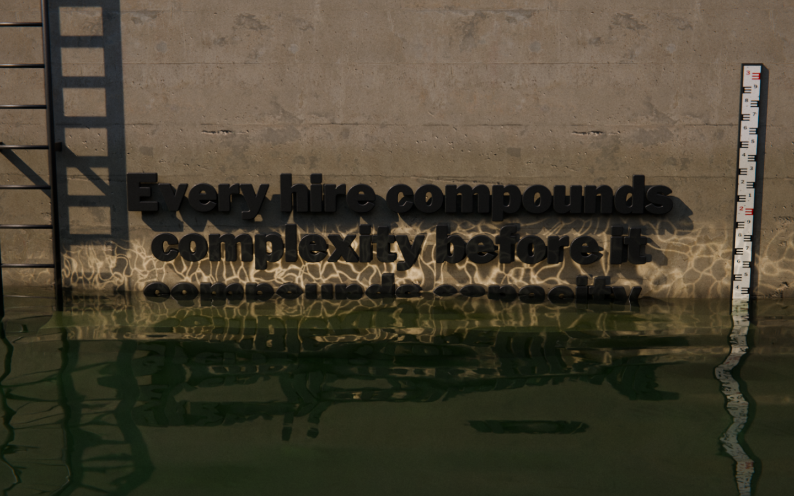
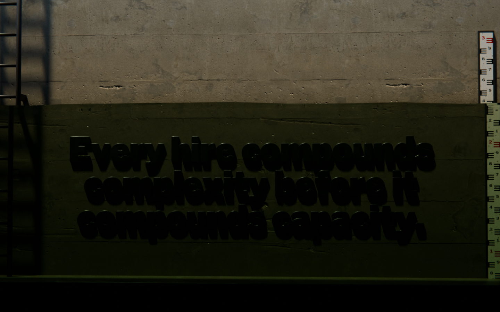

# 02 · AI TELLS

### What makes a website, and the pictures on it, look AI-generated or template-made in 2026, and what this site does instead

James, in his words:

> "it just feels so basic. The text on stuff looks AI-generated. I'm just like, I can't put that out there. It looks like it was AI-generated. It just seems flat. Nothing's high fidelity." [TASTE]

> "I don't want just a flat HTML element where you just click it and it just looks bad. ... Looks too AI-generated. I don't give that shit to my clients." [TASTE]

> "it can't look like a game. It can't look like AI" [TASTE]

> "all the shit you're building is like just like text, or ... AI generated images. It doesn't look good either." [TASTE]

And on 30 Oct, after seeing the four built options (from the project brief, not in TASTE.md):

> "it needs to not look ai. use blender to render everything so it wont look flat and ai made. it looks too ai made. find intresting fonts that ai wouldetn use. make your own."

**What this document is.** The definitive list of tells: the choices that make a page or a render read
as generated or templated, with evidence from our own four options, the rule we follow instead, and a
checklist a reviewer can run against a screenshot. It overrides section 11 of
[`briefs/BRIEF-waterline-render.md`](../briefs/BRIEF-waterline-render.md), as that brief says, and it
is the list [`03-TYPE.md`](03-TYPE.md) section 1 points to.

**How to use it.**
- Section 0 is the checklist: 25 questions, each answered from a screenshot or a still. Run it on every
  desktop (1440×900) and phone (390×844) screenshot and every render still before James sees it.
- Parts A (page) and B (renders) hold the full entries. Each tell has an ID (A01…, B01…) that the
  checklist cites, so a review can say *fails A13* and mean one thing.
- Part C runs the checklist against our current Blender look-dev. Part D lists the edits this asks of
  the render brief. Part E says how the evidence was gathered and how to re-run it.
- Code half of the checklist: `tools/ai_tells_scan.sh <src-dir>` prints every CSS/TS/HTML line that
  matches a mechanical tell, by ID (section E.2).

**Evidence.** The four options built before this round, with their screenshots:

| Short | Option | First screen, desktop | First screen, phone |
|---|---|---|---|
| TT | The Title | [desktop](../../susd-options/the-title/.shots/final/desktop-01-first-3s.png) | [phone](../../susd-options/the-title/.shots/final/phone-01-first-3s.png) |
| CY | Count Yourself | [desktop](../../susd-options/count-yourself/.shots/final/desktop-01-first-3s.png) | [phone](../../susd-options/count-yourself/.shots/final/phone-01-first-3s.png) |
| WL | Waterline (the CSS/WebGL one James said "could work") | [desktop](../../susd-options/waterline/.shots/final/desktop-01-first-3s.png) | [phone](../../susd-options/waterline/.shots/final/phone-01-first-3s.png) |
| CE | Corrected Edition | [desktop](../../susd-options/corrected-edition/.shots/final/desktop-01-first-3s.png) | [phone](../../susd-options/corrected-edition/.shots/final/phone-01-first-3s.png) |

---

## The idea behind every entry

*My reading.* A generated page is the average of the pages its generator learned from. At each
decision (face, colour, layout, button, shadow, motion, light) it takes the most likely option, and the
most likely option is the one the visitor has seen a thousand times. One default is invisible. Ten in
a row are recognised as *AI* in a second, by people who could not name a single one of them. That is
what James is reacting to when he says *basic*, *flat* and *AI-made* in the same breath.

So **a tell is any choice made because it is usual rather than because of this book.** The cure is the
same for the page and for the renders: every choice needs a reason a reviewer can name, either in the
book ([`01-MEANING.md`](01-MEANING.md), section 8) or in physics (light has a source, a shadow has a
caster, wear has a history, a lens has a focal length). If the only reason is *it looks nice* or *sites
like this do it*, it is a tell.

The book makes the same complaint about businesses, which is why this matters beyond taste:
"One-dimensional scaling looks like progress but it's just a line getting longer. You're not building volume. You're not building mass. You're just extending in one direction until you snap." [BL 812]
A page assembled from defaults looks like a website the way a line looks like progress (01-MEANING,
section 2).

**Four families of the generated look in 2026** (my grouping; a page usually mixes two):

| Family | What it is | Its signature |
|---|---|---|
| **1. The SaaS template** | What v0, Lovable and Bolt produce from shadcn/ui + Tailwind starters | Inter or Geist; a pill badge (`New`, `Introducing`) over a centred headline; gradient text; indigo or purple-to-blue glows; a dot-grid background fading at the edges; a bento grid of feature cards with line icons in tinted rounded squares; glass navbar; logo marquee; testimonials; FAQ accordion; `rounded-2xl` on everything |
| **2. The editorial-AI look** | What Claude and GPT produce when asked for something *tasteful*, *premium* or *editorial* | Warm off-white paper with grain; a soft serif (Fraunces, Instrument Serif, Newsreader) or a quirky grotesk (Bricolage) headline; tiny monospace labels in tracked capitals; middle-dot meta lines; one word in italic or an accent colour; hairline rules; eyebrow, headline, sub-head and two buttons, centred; pill buttons; three accent colours on cream |
| **3. The award-site template** | Copies of Awwwards winners without their reasons | A 0–100% preloader; a custom cursor circle; split-text letters rising on every heading; inertia scroll; horizontal-scroll sections; a marquee of giant words; a WebGL blob or a distortion shader on images; film-grain and burn overlays |
| **4. Generated or cheap imagery** | AI images, and stock-quality CG | AI images: hyper-detail, teal and orange, god rays, glowing bokeh, centred subject, nonsense lettering. Cheap CG: 3D text on a gradient, glossy clay shapes, objects floating with no contact shadow, studio-HDRI glow, everything sharp, nothing worn |

**All four of our options sit in family 2.** That is the precise diagnosis of "it looks too ai made".
None of them had a purple gradient or an emoji. They failed by stacking a dozen tasteful defaults:
cream, grain, a fashionable face, mono caps, dots, pills, a centred stack and the cover's three colours.

---

## 0. The checklist (run it on every screenshot and every still)

Answer each with **yes** or **no** from the image alone. The IDs point to the full entries. A wrong
answer in the first block stops the review. Anywhere else, fix it or write in the build README why it
stays.

**Five-second tests (the whole screen)**

| # | Question | Pass | IDs |
|---|---|---|---|
| 1 | **Squint.** Blur the screenshot, or step back three metres. Is Michael's sentence the biggest, brightest, highest-contrast thing on it? | yes | A15, B23 |
| 2 | **Swap.** Imagine another product's words in place of Michael's. Would the design still work as that product's page? | no | all |
| 3 | **Generator.** Could v0, Lovable, Claude or ChatGPT return this screen for *a landing page for a business book*? | no | all |
| 4 | **Zero clicks.** With no click and no hover, can you say what the book claims, who it is for (bootstrapped, 1 to 12 people) and where the Bootloader is? | yes | A34 |
| 5 | **Name the light.** Can you say where the render's light comes from and roughly what time of day it is, and is it true that no HTML element carries a shadow or glow of its own? | yes | A06, A12, B09 |

**The page (desktop and phone)**

| # | Question | Pass | IDs |
|---|---|---|---|
| 6 | Is every face on screen Plimsoll, Ortica or B612 (none from the default list in A01)? | yes | A01 |
| 7 | Is there any small text in tracked capitals, any monospace label, any letter-spaced word, or any string joined with `·`? | no | A02, A03, A05 |
| 8 | Is there any cream or paper-coloured background, grain overlay, gradient, or frosted-glass blur? | no | A07, A08, A10, A11 |
| 9 | Do the cover's green, mustard and red appear as flat fills, as a three-coloured word, or as one accent word in a headline? | no | A04, A09 |
| 10 | Is any screen a centred eyebrow, headline, sub-head and two buttons? Is the composition mirror-symmetric? | no | A13, A14 |
| 11 | Are there cards, two equal side-by-side panels, a bento grid, a CSS mockup of a book or file, stacked offset sheets, or drop shadows? | no | A12, A16, A21 |
| 12 | Are there decorative hairlines, `—— LABEL ——` dividers, big-number stat rows with tracked units, or tidy infographics? | no | A17, A18, A22 |
| 13 | Is there a pill or rounded button, a filled-plus-outline button pair, an icon set, an emoji, a chip, a chevron, or a hand-drawn arrow? | no | A20, A23–A27 |
| 14 | Is every sentence Michael's (cited), and is every label we wrote free of marketing verbs, arrows and em dashes? | yes | A36, A37 |
| 15 | On the scroll capture: does anything fade and rise, split into letters, count up on its own, keep drifting after the wheel stops, or need a hover or a click? | no | A30–A35 |

**The renders (each still at page size and at 100%)**

| # | Question | Pass | IDs |
|---|---|---|---|
| 16 | Are the words fixed to a real, nameable place, with things of known size in frame, rather than floating on a void, gradient or studio backdrop? | yes | B01, B03 |
| 17 | Zoom to every junction (letter and wall, wall and water, ladder and bracket). Is there a contact shadow or occlusion at each? | yes | B02 |
| 18 | Is there wear on the wall **and on the letters** (chips, rust bleed, stain, growth at the waterline), each with a cause? | yes | B04 |
| 19 | At 100%: are the materials scanned, with varied roughness, no visible tiling and no plastic? Do the letters look fabricated, not extruded? | yes | B05–B08 |
| 20 | Do all shadows fall one way, with no doubles and no shadow that copies a letter beside it? Do corners darken, do highlights roll off, and is the glitter subtle? | yes | B09–B14 |
| 21 | Is the lens real (35 to 85 mm, from where a person could stand), the verticals true, the frame not mirror-symmetric, the focus chosen, the vignette slight, with no flares? | yes | B15–B19 |
| 22 | At 100%: is the grain fine, luminance-only and different each frame, with no denoiser wax and no banding after packing? | yes | B20–B22 |
| 23 | At page size, do the dry words read at a glance, and are they the highest-contrast thing in the render? | yes | B23 |
| 24 | Step through five consecutive frames. Is there any boil, any pop, or a waterline that disagrees with the gauge? | no | B25 |
| 25 | Is every image ours (Blender) or a noted CC0 scan, with nothing generated? | yes | B24 |

---

## Part A. The page

### A.0 Which of our options does which

Read across a row to see a tell in all four options; read down a column to see one option's profile.
`·` and labels are quoted as they appear on screen. Counts in brackets are lines flagged by
`tools/ai_tells_scan.sh` in that option's `src/` (section E.2).

| ID | Tell | TT · The Title | CY · Count Yourself | WL · Waterline (CSS) | CE · Corrected Edition |
|---|---|---|---|---|---|
| A01 | Default faces | Archivo (wide axis) | Fraunces + IBM Plex Mono | Bricolage Grotesque + JetBrains Mono | Newsreader + Courier Prime |
| A02 | Tracked caps, mono labels | `MICHAEL WENTZ`, `THE SCOREBOARD`, `CYCLE 1` (12) | almost every label: `28 COORDINATION PATHWAYS`, `GET IT` (53) | `A BOOK BY MICHAEL WENTZ`, `SCROLL TO HIRE`, every gauge label (22) | `GALLEY 01 OF 06`, the Courier file line (11) |
| A03 | `·`-joined strings | hero meta line, button sub-label (11) | everywhere (50) | eyebrow, `TEAM · 8-12` (25) | byline, `8 people · 28 pathways` (14) |
| A04 | One accent word, italic headline | `They're not.` in red | whole headline in Fraunces italic | red half of the eyebrow | `higher` and `Oxygen.` in green |
| A05 | Wide display, spaced capitals | `S C A L I N G`, wide `UP-SIDE-DOWN` | | | |
| A06 | CSS fake depth on type | stacked text-shadow extrusion (5) | | (1) | letterpress text-shadow (17) |
| A07 | Cream paper | whole page | cards on green | the dry half | the galley sheet |
| A08 | Grain overlay | yes | yes | yes | yes |
| A09 | Cover colours as flat fills | the title word in three colours | logo stripes, meter bar, cover | gold figures, red labels, green water | three-colour cycle line, red marks |
| A10 | Gradients | | | the water is a CSS gradient | |
| A12 | CSS shadows, stacked sheets | button, book, sheets (27) | cards, counter (16) | button, sheets (13) | the sheet, the button (9) |
| A13 | Centred eyebrow stack | yes | yes | yes | yes |
| A14 | Mirror symmetry | yes | yes | mostly (gauge at right) | yes |
| A16 | Two equal cards for the paths | book half, file half | two cards | two halves | |
| A17 | Decorative hairlines | nav rule, caption underlines | `—— TWO PATHS ——` | `—— COMPLEXITY ——` | running-head rule |
| A18 | Big number + tracked unit | | `08`, `35,445 words` | `8 PEOPLE · 28 LINES OF COMMUNICATION` | |
| A19 | Standard nav with pill | yes | yes | yes | running head (better) |
| A20 | Scroll cue glyph | chevron | | `SCROLL TO HIRE` + chevron | `GALLEY 01 OF 06 ↓` |
| A21 | CSS mockups | book cover; file pages with line numbers | book cover; file icon | stacked sheets | |
| A22 | Brand-coloured infographic | cycle steps | bar chart, meter bar | (the gauge is functional) | three-colour step line |
| A23 | Pill buttons | yes | yes | yes | square |
| A24 | Filled + outline pair | pill + underlined link | cream pill + outline pill | pill + link | red button + outlined box |
| A25 | Icons | chevron | circled − and +, file icon, circled ? | chevron | arrow |
| A26 | Chips | | `8 · TEAM`, dashed `PRE-ORDERS OPEN SOON` | | |
| A27 | Fake handwriting, marginalia | | `Set your number` with a drawn arrow | | proofreader's marks (the concept) |
| A30 | Reveal motion | (37) | (28) | (27) | (11) |
| A31 | Rubber-stamp slam | `Yours` stamp: rotate, scale 1.3, blur | | the same stamp | |
| A35 | Inertia scroll library | Lenis | | Lenis | |
| A38 | Phone template | full-width pill stack | sticky two-pill bar | gauge numbers crowd the headline | sticky two-button bar |

What survives from the old Waterline is its **meaning**, not its surface: the thesis as the hero words,
the water level following the pathways, the band gauge, and the drain on opt-in. Every row above where
WL is marked is surface, and all of it goes.

### A.1 Type

**A01 · The default faces.**
- *Tell.* The faces that come back again and again from generators and the starters they build on.
  Nobody names them, but everybody has seen them a thousand times, so the page reads as *a website*
  before it reads as *this book*.
  - **Sans, for interface and body:** Inter, Inter Tight, Geist (the Next.js starter default), Roboto,
    Open Sans, Lato, Montserrat, Poppins, DM Sans, Manrope, Outfit, Sora, Plus Jakarta Sans, Figtree,
    Onest, Urbanist, Lexend, Work Sans, Nunito, Rubik, Mona Sans, Hanken Grotesk, IBM Plex Sans, Satoshi,
    General Sans.
  - **Display grotesks:** Space Grotesk, Bricolage Grotesque, Clash Display, Cabinet Grotesk, Syne,
    Unbounded, Archivo (and its Expanded and Black cuts), Familjen Grotesk, Schibsted Grotesk,
    Instrument Sans, Funnel Display, Host Grotesk.
  - **Serifs:** Fraunces, Instrument Serif, Newsreader, Playfair Display, Lora, Libre Baskerville,
    EB Garamond, Cormorant, Crimson Pro, Source Serif, DM Serif Display, IBM Plex Serif.
  - **Monospace:** JetBrains Mono, IBM Plex Mono, Geist Mono, Space Mono, DM Mono, Roboto Mono, Fira Code,
    Source Code Pro, Courier Prime.
- *Ours.* All four options used them: TT Archivo; CY Fraunces with IBM Plex Mono; WL Bricolage Grotesque
  with JetBrains Mono; CE Newsreader with Courier Prime.
- *Rule.* The system in [`03-TYPE.md`](03-TYPE.md), section 0. **Plimsoll Heavy** (ours) for the rendered
  sentence, the title, the figures, the equations and the Bootloader's name. **Ortica Angular Bold** for
  Michael's beat lines. **Ortica Linear** for support lines. **B612** for labels and the form. Any new
  face must not be on this list and must pass 03-TYPE section 1.

**A02 · Small labels in tracked capitals, or in monospace.**
- *Tell.* `A BOOK BY MICHAEL WENTZ`, `28 COORDINATION PATHWAYS`, `GALLEY 01 OF 06`: 11 to 13 px,
  letter-spaced 0.1 to 0.2 em, often monospace. It is the single most reliable editorial-AI tell, because
  generators use it to make anything look designed.
- *Ours.* All four (A.0).
- *Rule.* Labels are **B612 in sentence case with normal spacing** (`Team 8–12`, `coordination pathways`).
  A label exists only if the screen fails without it. No monospace anywhere, the file name included
  (`SUSD Bootloader` is set in Plimsoll).

**A03 · Strings joined with middle dots.**
- *Tell.* `A book by Michael Wentz · For bootstrapped founders · Teams of 1–12`. Joining facts with `·`
  lets a generator put four facts on one line without deciding which matters. It reads as a template
  meta row.
- *Ours.* All four, CY on 50 lines. Our own type specimen and the render brief still do it (Part D).
- *Rule.* One fact per line, or one of Michael's sentences. Where facts must sit together (the file's),
  stack them as a short spec: name over values, each on its own line (Part D gives the exact text). A
  real sentence such as `Works with Claude, ChatGPT and Gemini` uses commas, not dots.

**A04 · One word picked out, or the soft italic headline.**
- *Tell.* A headline where one word is italic or in the accent colour (`They're not.` in red, `higher`
  in green), or a whole headline in a soft serif italic. It is a generator's way of adding emphasis
  without composing.
- *Ours.* TT, CE, and CY's Fraunces italic headline.
- *Rule.* No typographic emphasis inside Michael's sentences. Emphasis on this site is a physical event:
  the water touches the words at thirteen. The two equations are the only coloured type, and they are
  coloured whole (`--redline`, `--oxygen`), never one word.

**A05 · Wide display type, and capitals spaced out.**
- *Tell.* An expanded grotesk in capitals (TT's `UP-SIDE-DOWN`), or a word spaced out over a title
  (`S C A L I N G`). This is the startup and streetwear look (03-TYPE, section 2, on Messapia and Mattone).
- *Ours.* TT.
- *Rule.* Plimsoll's proportions, tracked at most 0.03 (03-TYPE, section 5.4). Never letter-space a word
  for effect.

**A06 · Fake depth on type with CSS.**
- *Tell.* `text-shadow` stacked into an extrusion (TT's 3D title and `USD`), letterpress and emboss
  (CE), glow. CSS depth has no light source, so it reads as WordArt: the flatness James named, wearing
  a costume.
- *Ours.* TT, CE.
- *Rule.* No `text-shadow` on any HTML text. Depth exists only in the renders, where the light is real.
  If HTML text needs help to read over the render, use a measured scrim (brief 7.7), not a shadow.

### A.2 Colour and surface

**A07 · Cream, beige or paper backgrounds.**
- *Tell.* `#EDE7DC` and its cousins: the colour generators reach for when asked for *warm*, *premium*
  or *bookish*.
- *Ours.* TT (the whole page), WL (the dry half), CE (the galley sheet), CY (its cards).
- *Rule.* **The page background is the render.** Below it, `--deep #0D1110`, the render's darkest water.
  There is no paper on this site.

**A08 · Grain or noise overlay.**
- *Tell.* An SVG `feTurbulence` tile over the whole page to make flat colour look *tactile*. It sits on top
  of type and buttons, which no camera or press would do, and every AI-made page with taste has it.
- *Ours.* All four.
- *Rule.* Grain lives only inside the rendered frames, from the compositor (B20). No overlay on HTML.

**A09 · The cover's three colours as flat fills.**
- *Tell.* Green, mustard and red as text colours, bars, stripes and underlines on cream. A three-accent
  palette applied evenly is a theme, not a decision, and on this book it also turns Up, Side and Down
  into a traffic light.
- *Ours.* All four (A.0).
- *Rule.* As brief section 11. The cover colours never appear as flat fills. Green and red exist as **real
  light in the render** (the lock signal) and as the two equations' text. The water's green comes from
  its absorption colour (05, section 5), so it is physics, not paint.

**A10 · Gradients.**
- *Tell.* Purple to blue, indigo glows, mesh and *aurora* blobs, gradient text (`background-clip: text`),
  a dot grid fading at the edges. Also WL's water: a CSS gradient under a sine-wave edge, which is exactly
  what *flat* meant.
- *Ours.* WL's water. None of the options used the purple family.
- *Rule.* No gradients. The one exception is a **measured scrim** behind HTML text over a busy part of a
  frame (brief 7.7: radial, at most 40% black, listed per frame range).

**A11 · Glass and blur.**
- *Tell.* A translucent frosted navbar or card (`backdrop-filter`), and things that *blur in* from
  `blur(2px)`.
- *Ours.* TT and WL blur their `Yours` stamp in (`blur(2px)` to `blur(0)`).
- *Rule.* No glass and no blur effects. The phone bar is a solid strip (brief 6.2). The only blur is
  optical, inside the render.

**A12 · CSS shadows and stacked sheets.**
- *Tell.* Soft `box-shadow` on cards and buttons (`0 1px 2px` plus a long soft one), and a pile of
  sheets offset 6 px and 12 px to mean *document*. Shadows without a light are the clearest sign that
  depth was added rather than lit.
- *Ours.* All four. TT and WL both drew the Bootloader as stacked sheets.
- *Rule.* **Every shadow and highlight on screen is rendered.** No `box-shadow`, no `drop-shadow`, no
  offset sheets.

### A.3 Layout and composition

**A13 · The centred stack.**
- *Tell.* Eyebrow, headline, sub-head, two buttons (a filled primary and an outline or link secondary),
  centred, repeated for every section. It is the most common landing-page hero there is.
- *Ours.* All four first screens: TT almost exactly; CY with a widget in the middle; WL with eyebrow and
  headline; CE with a struck-out eyebrow.
- *Rule.* Brief 4.1: **four quiet corners around one lit sentence.** The title lockup at top left, the
  book link and the Bootloader dock at top right, the audience at left on the water, the instrument
  column at right on the water. The centre of the water stays empty for the words' reflection. Story
  lines use one caption slot on the water, never an eyebrow above a headline.

**A14 · Mirror symmetry.**
- *Tell.* Everything centred on one vertical axis, equal margins, equal weights. Generators centre
  because it is never wrong; it is never interesting either.
- *Ours.* All four. WL's gauge on the right was the only asymmetry, and it is the one part that felt
  like an instrument.
- *Rule.* The render may be frontal (B16), but the page is asymmetric for a reason: the light rakes from
  the left, the gauge and the ⦵ mark stand at the right, the audience sits at left and the instruments at
  right. Nothing is placed twice for balance.

**A15 · A caption beside or over a picture.**
- *Tell.* A dominant image with small left-aligned text beside or over it. This is James's complaint of
  this round: "If you have blocks and left aligned text then rn you just look at the blocks and don't
  read the text." [TASTE] (the old Blender site did this).
- *Ours.* The old Blender site. The four options avoided it by making type the picture, and then
  flattened it (A06, A07).
- *Rule.* The words are the picture: Michael's thesis is the rendered object. HTML captions sit in one
  slot on dark water and are always secondary to the rendered sentence (checklist question 1).

**A16 · Two equal cards, bento grids, feature grids.**
- *Tell.* The *two paths* as twin cards of equal size, or any grid of rounded cards with an icon, a
  title and two lines each.
- *Ours.* TT, CY and WL split the paths into equal halves.
- *Rule.* No cards. The Bootloader is primary and the book secondary, so they are unequal by design:
  the Bootloader gets the form and the ⦵ mark, and the book gets one quiet line (`Pre-orders open soon`).

**A17 · Decorative hairlines.**
- *Tell.* 1 px rules under the nav, around section labels (`—— TWO PATHS ——`) and under captions. They
  fake structure on a page that has none.
- *Ours.* All four.
- *Rule.* A line must be a **measurement**: the waterline, the ⦵ bar, the `margin` dimension line with
  end ticks, an anchored label's leader (brief 5), the form field's edge. Nothing else.

**A18 · The stat row.**
- *Tell.* A big number with a small tracked unit (`8 PEOPLE · 28 LINES OF COMMUNICATION`), lifted from
  SaaS metric strips.
- *Ours.* WL, CY.
- *Rule.* The readout is an instrument: Plimsoll figures over B612 units in sentence case, stacked
  (`8` over `people`, `28` over `coordination pathways`), with tabular figures so nothing jitters. A
  number changes only when the water changes with it.

**A19 · The standard navbar.**
- *Tell.* Logo at left; links and a pill CTA at right; sticky; often frosted.
- *Ours.* TT, CY, WL. CE's running head (name, title, action, like a book's page header) was closer to
  something of its own.
- *Rule.* The corners of brief 4.1: the title lockup at left, and at right `The book` as a text link
  beside the Bootloader dock (⦵, name, facts, one square button) in the render's reserved top band. No
  bar and no background behind it: the band is dark wall in every frame.

**A20 · Scroll cues.**
- *Tell.* A chevron, a bouncing arrow, `SCROLL`, or a thin line that keeps growing downward.
- *Ours.* TT, WL, CE.
- *Rule.* The intro is the cue: the lock fills to eight on arrival (brief 4.1) and stops, with the water
  visibly below the words. If words are needed, one plain B612 sentence with no glyph and no animated
  line (Part D).

**A21 · CSS mockups.**
- *Tell.* A book cover drawn in HTML with a spine shadow, a document as stacked pages with line numbers,
  a file icon, a device frame. For a book site, the floating 3D book mockup at an angle is the stock
  answer.
- *Ours.* TT (cover and file pages), CY (cover card and file icon), WL (stacked sheets).
- *Rule.* No mockups. The Bootloader is named and specified, not illustrated. The book appears as its
  title and its status until a real cover file exists; after that, it is photographed or rendered lying
  in a real place, never floating.

**A22 · The tidy infographic.**
- *Tell.* A brand-coloured SVG diagram standing in for the idea: step lines, sparklines, bar charts,
  cycle arrows. It explains, and it is flat by construction.
- *Ours.* TT (cycle steps), CY (bar chart, meter bar), CE (three-colour step line).
- *Rule.* The scene is the diagram: the water level *is* the pathways curve, each cycle's course of
  concrete *is* the step up, and the tide ring *is* the record. Labels anchor to physical things
  (`complexity` on the waterline, `capacity` on the landing).

### A.4 Components

**A23 · Pills and big radii.** *Tell:* fully rounded buttons and `rounded-2xl` everything, the shadcn
look. *Ours:* TT, CY, WL. *Rule:* every control is square, with a 1.5 to 2 px border or a solid cream
fill (brief 11). There are no radii on the page.

**A24 · A filled button beside an outline button.** *Tell:* the primary-and-ghost pair, with equal
billing for unequal actions. *Ours:* all four. *Rule:* one button per screen, `Get the free Bootloader`
(or `Get it free` in the dock). The book is a text line.

**A25 · Icon sets, emoji, symbols.** *Tell:* Lucide, Heroicons or Phosphor icons, circled `−` and `+`,
`✨`, `✓`, `→`, `↓`, `⌄`. *Ours:* CY's circled controls and file icon; chevrons and arrows in TT, WL
and CE. *Rule:* **⦵ is the only icon** (Plimsoll's load-line mark, the Bootloader's mark). No emoji and
no arrows anywhere, buttons included.

**A26 · Chips and badges.** *Tell:* `New`, `Free`, `8 · TEAM`, dashed-border pills. *Ours:* CY.
*Rule:* none. Status is a word in a sentence (`Pre-orders open soon`).

**A27 · Fake handwriting and marginalia.** *Tell:* an italic note with a hand-drawn arrow (`Set your
number`), scribbles, proofreader's marks, sticky notes: *human touch* added as a decoration. *Ours:* CY;
CE's whole concept. *Rule:* none. The human trace on this site is wear in the render (B04), which has
a cause.

**A28 · Social proof we do not have.** *Tell:* logo walls, star ratings, testimonial cards, `Join 10,000
founders`. *Ours:* none, correctly. *Rule:* never, unless Michael supplies a real, attributable line.

**A29 · The boxed email capture.** *Tell:* a card holding an input and a black button, with `No spam.
Unsubscribe anytime.` under it. *Ours:* CY's card with `GET IT`. *Rule:* one form on the page, in the
finale, set on the render with a visible label (brief 6.4). Microcopy states only what is true of
this form, in the brief's words.

### A.5 Motion

**A30 · Fade and rise on scroll.** *Tell:* every block enters with opacity 0 to 1 and a 12 to 24 px
rise, often staggered. It is the default animation of every component library. *Ours:* all four (A.0
counts). *Rule:* **nothing moves for looks.** The water moves by physics, scrubbed by scroll. Captions
change like film subtitles: an opacity crossfade with no movement (Part D).

**A31 · Type tricks and slams.** *Tell:* split-text letters rising one by one, typewriter text,
numbers counting up by themselves, marquees, a rubber stamp that slams in rotated, scaled and blurred.
*Ours:* TT and WL's `Yours` stamp. *Rule:* none. The only motion type has is the water against the
rendered letters. Readout numbers move only with the water (brief 4.1's intro count is locked to the
fill).

**A32 · Preloaders.** *Tell:* a 0–100% counter or a logo animation before anything shows. *Ours:*
none. *Rule:* the first paint is a real frame (d00, brief 4.1). Frames stream in behind it.

**A33 · Cursor effects.** *Tell:* a custom cursor circle, magnetic buttons, a glow that follows the
pointer, cards that tilt on hover. *Ours:* none on screen. *Rule:* the native cursor, and no
pointer-driven effects.

**A34 · Hover-only and click-to-reveal.** *Tell:* content that exists only on hover, behind a toggle,
or in a dial (CY's `+` and `−`). It also breaks James's rule: "the user should only need to scroll
nothing else if they don't want to." *Rule:* scroll only. Clicks exist for the two paths and nothing
else.

**A35 · Scroll that fights the hand.** *Tell:* heavy inertia scrolling that keeps drifting after the
wheel stops, horizontal-scroll sections, sections that trap the wheel. *Ours:* Lenis in TT and WL.
*Rule:* native scroll on touch (brief 8). If Lenis stays on desktop (brief 9.1), keep its defaults; no
horizontal sections; the frame shown always follows the scroll position. Smoothness comes from the
crossfade between frames, not from delaying the page.

### A.6 Copy (only the few words we write)

Every sentence on the site is Michael's, word for word and cited, so the generated-prose tells can only
creep in through labels, buttons and microcopy.

**A36 · Marketing verbs.** *Tell:* `Unlock`, `Elevate`, `Supercharge`, `Seamless`, `Reimagined`,
`Get started`, `Learn more`, `Discover`, `Dive in`, `Your journey`. *Rule:* labels are nouns and plain
verbs from the book and the file: `Get the free Bootloader`, `Read the Appendix`, `The book`,
`Email address`, `coordination pathways`.

**A37 · Generated rhythm.** *Tell:* em dashes in our own labels, `Not X. Y.` constructions, sets of
three, a question followed by its answer. *Rule:* none of these in anything we write. Michael's own
punctuation, em dashes included, is kept exactly as he wrote it.

### A.7 Phone

**A38 · The phone template.** *Tell:* everything centred in one column at equal gaps, full-width pills
stacked, a sticky bottom bar of two equal buttons, chrome laid over the headline. *Ours:* TT (full-width
pill stack), CY and CE (sticky two-button bars), WL (gauge numbers crowding the headline). *Rule:* the phone
gets its own portrait render with the sentence in six lines (brief 4.2). One sticky **Bootloader** bar
(⦵, name, facts, one square button), a solid strip with no glass. The book is the text link at the top.
Nothing overlaps the sentence.

---

## Part B. The renders

### B.0 What makes a render look photographed

*My summary of the rules below, in one paragraph for the render team.* A photograph is evidence of a
place. It has a location you could visit, one light you could name, surfaces that remember what happened
to them, objects that rest on and press into other objects, and a camera that stood somewhere and was
focused on something. CG looks fake when any of these is missing: when the object floats, the light
comes from nowhere, the surfaces are new, the edges are perfect, the lens is impossible, or the finish
is either too clean or uniformly dirty. AI images fail differently, by being too much of everything
(detail, drama, glow) and wrong in the mechanics (letters that are not letters, ladders that do not
join). The reference class for this site is industrial documentary photography: frontal records of
structures, as in Bernd and Hilla Becher's water towers, and the colour industrial landscapes of Edward
Burtynsky, including his dams and water. Draught marks on a ship's hull, which are welded steel numerals
that water rises against, are the closest real object to our letters.

### B.1 Staging

**B01 · Text in a void.** *Tell:* 3D letters on a gradient, in black space, or on a seamless studio
cyclorama, sometimes on a plinth or turning on a turntable (James on the plinth: "that just doesn't seem
cool" [TASTE]). *Ours:* the glass-tank staging (a) was a set, not a place (Part C). *Rule:* the words
are fixed to a place whose job is the story: the lock wall (05, section 0). The world runs off the edges
of the frame (the ladder cut by the left edge, the coping by the top). A product shot frames everything
with air around it; a photograph of a place does not.

**B02 · Floating objects.** *Tell:* no contact shadow and no ambient occlusion where one thing meets
another, so objects hover a millimetre off their surface. *Rule:* zoom to every junction: letter to
wall, landing to wall, wall to water, ladder to its brackets, brackets to the wall, gauge to its posts.
Each needs a dark contact line or occlusion. Mounted letters stand 2 to 3 cm proud on studs, as real
sign letters do, and the studs are visible in raking light.

**B03 · No scale.** *Tell:* nothing of known size in frame, so the scene could be a tabletop toy (the
tilt-shift miniature look). *Rule:* keep the scale objects 05 uses: ladder rungs every 0.3 m, the
E-pattern staff gauge, form-tie holes, the coping. Their numbers and spacing must be real: an E-gauge
counts correctly, and a ladder is bolted to the wall.

**B04 · Nothing has a history.** *Tell:* every surface brand new and clean, or the opposite: one grunge
texture laid evenly over everything, which is as fake as none. *Rule:* imperfection follows a cause:
- rust bleeds **down** from fixings;
- silt stains sit **below** high-water marks, with a ragged top edge;
- algae and biofilm grow in the band that stays wet and gets light;
- dust and grit sit on **upward** faces (letter tops, the landing);
- paint chips at **edges and corners**, where things get hit;
- efflorescence blooms where water seeps through concrete.

The letters live there too, so they get the same history as the wall: a wet band and tide ring once
the water has touched them, chipped enamel on the edges, and rust weeping from the studs.

### B.2 Materials

**B05 · Procedural or tiled surfaces.** *Tell:* noise-texture concrete, a visible repeat, the same
blemish twice. *Rule:* scanned materials (Poly Haven `concrete_wall_007`, 05 section 8) at real scale
(one tile is about 2.8 m). Break the repeat with stain and wet layers that do not tile with it. Check the
whole frame for the same feature appearing twice.

**B06 · Plastic.** *Tell:* one roughness value for a whole object, so it is uniformly glossy or
uniformly matte. *Rule:* roughness comes from scanned maps and varies across every surface (05: enamel
0.48 ± 0.11 from a map, with orange-peel bump). Wet concrete is darker and glossier than dry; worn edges
are shinier than faces.

**B07 · Extruded WordArt.** *Tell:* letters with a pillow bevel, chrome, gold, glass, or balloon
inflation, or razor edges that catch no light. This is the look of *3D text*, and James's "it can't look
like a game" [TASTE] is about it. *Rule:* letters are fabricated the way a sign-maker makes them: cut steel
3.5 cm deep with a small real edge break (1 to 2 mm) that catches a thin highlight, painted, fixed on
studs, kerned (Blender ignores kerning: 05 pitfall 13). The set is Plimsoll Heavy capitals (03-TYPE).

**B08 · Game water.** *Tell:* a tiling normal-map surface with a fresnel gradient, perfectly regular
waves, a waterline drawn as a straight line on the wall, reflections that do not ripple. *Rule:* 05's
water: real geometry, IOR 1.333, depth colour from absorption, light wind chop, an irregular waterline
with a 12 cm wet band above it, and reflections broken by the chop.

### B.3 Light

**B09 · Light from nowhere.** *Tell:* a generic studio HDRI glow, evenly lit from all round, with no
direction to the shadows. *Rule:* **one key light with a source you can name**: the sun at 42°, raking
from the left (05, section 5), with fill from an outdoor sky HDRI. Every shadow in the frame falls the
same way: check the ladder's shadow against the letters' shadows.

**B10 · Double and unmotivated lights.** *Tell:* two shadows per object (the HDRI's sun plus a sun
lamp), a rim light outlining the letters, coloured lights with no fitting in the scene. *Rule:* clamp the
HDRI's sun (05 pitfall 12). Add no light without a cause in the scene. The glitter projector is allowed
because it reproduces something the sun on the water really does (05 pitfall 8).

**B11 · Drop-shadow type.** *Tell:* each letter throws a full, offset copy of itself onto the wall, so
the sentence reads as text with a Photoshop drop shadow. *Rule:* 05 pitfall 7. Keep the standoff small
(2 to 3 cm), soften the sun disc (2° to 3°), and avoid a sun that only grazes the wall. A real mounted
letter throws a short, soft shadow that touches its own foot.

**B12 · Even, uncanny light.** *Tell:* no falloff, no darkening in corners and under overhangs, a 6 m
wall equally bright top to bottom, neutral grey or black shadows. *Rule:* raking light falls off, corners
and the coping's underside go dark, and outdoor shadows take the sky's cool colour. Expose like a
photographer (05: +0.8 EV) rather than adding lights.

**B13 · Clipped or over-graded light.** *Tell:* highlights blown to flat white, HDR halos, oversaturated
colour, the teal-and-orange grade. *Rule:* AgX Medium High Contrast (05). Highlights on the gauge and the
glitter roll off rather than clip. Colour comes from materials and light, never from a grade.

**B14 · The swimming-pool net.** *Tell:* bright, regular caustic lines across the whole wall. Sun
glitter on a lock wall is broken, faint and patchy. *Rule:* `--wc 0.3` for finals (05), and break the
band up so it is not even along its length.

### B.4 Camera and lens

**B15 · Impossible cameras.** *Tell:* Blender's default three-quarter view from above, a fisheye, an
orthographic view, a camera hanging where no tripod could stand. *Rule:* 35 to 85 mm full-frame
equivalent, from a place a person could stand: the far coping, 3 m up, 50 mm (open view); eye level
1.65 m in the gallery, 50 mm (window view); about 35 mm equivalent for the phone camera.

**B16 · Symmetry.** *Tell:* a mirror-symmetric scene, with props in matched pairs and equal spacing left
and right. *Rule:* a frontal record of a structure is a real photographic form (the Bechers), so the
camera may be square to the wall with true verticals. What must not be symmetric is the scene. The
ladder, gauge, ⦵ mark and signal are where the lock needs them, not placed to balance each other.

**B17 · Focus nobody chose.** *Tell:* everything sharp from 1 m to infinity in a close scene, or
tilt-shift blur that turns the place into a model. *Rule:* depth of field follows the stated lens. At
8.4 m with 50 mm at f/8, nearly the whole wall is sharp, and that is correct. At f/5.6 in the
gallery, anything well in front of the wall may soften slightly. Focus is always on the words.

**B18 · Lens effects as decoration.** *Tell:* heavy vignette, chromatic aberration across the whole
frame, lens flares, anamorphic streaks, *cinematic* letterbox bars. Equally, no lens at all. *Rule:*
05's finish: a vignette plate at 0.22, lateral colour at 0.004 (visible only at the edges), a fog glow at
0.12 above 1.2. Flares only if the sun is in frame, and it never is.

**B19 · Impossible camera moves.** *Tell:* orbits, swoops and dolly zooms that no crew could rig.
*Rule:* the camera is fixed, or makes one slow move with a reason (brief 7: Side lifts the words, so the
camera follows half the rise). Cuts are hard cuts, as in film (brief 5, beat 4).

### B.5 Finish

**B20 · Grain done wrong.** *Tell:* no grain, so the surfaces are plasticky clean, or a static grain
overlay that is identical on every frame, or colour noise. *Rule:* luminance grain from the compositor
(05: plate at 0.07, overlay, shifted every frame), fine enough to vanish at half size. Add it before
packing and check it after (B22).

**B21 · Denoiser wax.** *Tell:* OIDN smoothing concrete pores into wax, rust into blotches, ripples into
watercolour. *Rule:* albedo and normal passes, prefilter Accurate (05). Crop every still at 100% around
the letters and the waterline. If the pores have gone, raise the samples for that range of frames.

**B22 · Banding after packing.** *Tell:* stepped bands in the dark water and in the shadows after WebP
or AVIF compression. *Rule:* render to 8-bit PNG with the grain in it, then pack. Check the darkest water
of every packed tier at 100%, and raise the quality only for the frames that band.

**B23 · Pretty but unreadable.** *Tell:* a beautiful frame in which the sentence is not the first thing
you read. This was the old blocks site's failure, and it is the one James cares about most. *Rule:* at
page size, the dry words read at a glance and are the highest-contrast thing in the frame (05, section
3; checklist questions 1 and 23). If the letters cannot win against the wall, change the letters' paint
(ships' draught marks are white for this reason) before you add a scrim.

### B.6 Provenance and sequence

**B24 · AI images and their marks.** *Tell:* any generated image or video, and the signs of one in
assets taken from elsewhere: lettering that is not quite letters, melted geometry, mechanics that cannot
work (rungs that do not meet the rails, a gauge whose numbers do not count), detail that is dense but
means nothing. *Rule:* no AI images or video, ever (TASTE section 8). Every object is modelled by us or
is a CC0 scan whose source is noted in 05 section 8.

**B25 · Boil and pop in sequences.** *Tell:* static areas shimmering from frame to frame (denoiser
noise), objects popping between frames, a waterline that disagrees with the gauge's reading. *Rule:* a
fixed seed and persistent data (05); the level is set from the pathways map (brief 3), so the gauge
reading and the readout always agree. Check five consecutive frames as a flip-book.

---

## Part C. Our current look-dev, run through the checklist

Judged at page size and at 100%. Crops were made for this review and are not kept.

**C1 · Open water, `lookdev/full/c_lock_1440_s32.png`** (05's best open-water still, Libre Franklin
stand-in type).



- **Passes.**
  - B01: a nameable place.
  - B03: ladder and gauge give the scale.
  - B05: scanned concrete with tie holes and pour lines.
  - B08: an irregular waterline and rippled reflections of the ladder and gauge.
  - B09: one sun from the left; the ladder's shadow agrees.
  - B15, B16: a 50 mm lens from the coping, with true verticals.
  - B13: the gauge's white holds.
  - The ladder cut by the left edge makes it a place, not a product shot.
- **Fails, in order of cost.**
  1. **B11, drop-shadow type.** Every letter throws an offset copy of itself down and to the right, as
     dark as the letter, so at 100% the top line reads as text with a drop shadow.
  2. **B07 and B04, WordArt letters.** The letters are pristine satin black with soft rounded edges: no
     studs, chips, rust or wet band, although the wall around them has all of these. At 100% they read
     as extruded 3D text set against a real wall.
  3. **B14, the pool net.** The glitter is bright, regular and even along the whole width at one
     height.
  4. **B23, contrast.** The letter band measures about 35/255 mean luminance against the wall's 111, and
     their shadows are the same tone as the letters, so the edges merge. The glitter breaks up line two.
     The gauge, not the sentence, is the highest-contrast thing in the frame.
- **Advisory.** Ladder at left and gauge at right bracket the words like parentheses. That is acceptable
  for a frontal record, but do not add anything that mirrors it (B16).

**C2 · Drowned, through the gallery window, `lookdev/full/c_window_1440_s32.png`.**



- **Passes.** B01 (the same lock), B03 (ladder and gauge continue under water), B15 (eye level, 50 mm).
- **Fails.**
  - **B07, strongly.** Near-black letters on near-black wall with a pillow edge and a soft dark halo all
    round. At 100% this is a bevel-and-emboss effect, the clearest *3D text* tell in our look-dev.
  - **B12 and B23.** Evenly dim and murky, with nothing to show where the light comes from under the
    water and very little contrast.
  - The glass edge is a perfectly straight, hard horizontal, and the bottom tenth of the frame is pure
    black, so the frame reads as a constructed set.
- **What a real underwater view has, and this needs.**
  - Sun through the surface dappling the letters and the wall (caustics on the letters, not only the
    floor).
  - A lit upper edge on each letter.
  - Suspended particles catching light.
  - Wall texture fading with distance.
  - Some detail in the gallery below the glass, or a crop that removes it.

**C3 · The glass tank, `lookdev/sheets/a_contact.png`** (already rejected in 05). Cream letters on
stacked blocks in a tank under flat grey light. It reads as a tabletop product render: B01 (a set, not a
place) and B12 (studio-even light). The lock was the right replacement.

**C4 · The type team's lock test in Plimsoll, `docs/type/specimens/3d/lock-over-plimsoll-set.png`.**
The capitals on a flat baseline read well, and the water meets every letter at once, as 03-TYPE intended.
The same B11 shadow copies and B14 net break up the bottom line.

**Summary for the render job.** The place, the water, the scale and the lens already pass. The words do
not yet. Fix the letters (B07, B11, B04) and the glitter (B14), then re-check contrast (B23) before
sequences are rendered. These are cheaper to fix now than after 72 frames.

---

## Part D. What this asks of the render brief

[`briefs/BRIEF-waterline-render.md`](../briefs/BRIEF-waterline-render.md) already follows most of these
rules (section 11). Where it does not, this document wins.

| Brief | Now | Change to | Why |
|---|---|---|---|
| 4.1, 4.2, 6.1, 6.2, 6.6 (lines 182, 216, 281, 299, 398); 14 (line 823); `copy-deck.waterline-render.ts` line 25 (`meta`) | `Free file · V16 · 35,445 words` | Stacked under the name, one fact per line: `Free file` / `Version 16, 35,445 words`. Where space allows, a third line: `Works with Claude, ChatGPT and Gemini`. | A03 |
| 6.3; `copy-deck.waterline-render.ts` line 112 (`fileMeta`, `Free · V16 · 35,445 words · Markdown`) | `Free · V16 · 35,445 words · Works with Claude, ChatGPT, Gemini` | The same stacked spec, with `Markdown file` as its own line | A03 |
| 4.1 (line 214) readout | `8 people · 28 coordination pathways` | `8` over `people`, `28` over `coordination pathways` | A03, A18 |
| 4.2 (line 219), phone docked readout | `13 people · 78 pathways · Threshold 13–14` | `13 people, 78 pathways` / `Threshold 13–14` on two short lines, or the figures alone with the band name | A03 |
| 8 (line 588), phone legend | `Up · Side · Down` | three separate labels, `Up`, `Side`, `Down`, spaced apart with no separator, the lit phase in cream (not "Up. Side. Down.", which would cut Michael's line [M 1713 · copy.ts:125]) | A03 |
| 11 (line 723), footer | `Scaling Up‑Side‑Down · Michael Wentz` | Two lines: title, then name | A03 |
| 5, caption slot (line 233) | fades in over 10vh *with a 12 px rise* | an opacity crossfade only, no rise (subtitles) | A30 |
| 4.1, scroll cue | a 1 px rule growing downward every 2.4 s | the sentence alone, still; the intro's fill is the cue | A20 |
| 9.1 | Lenis 1.1.13 on desktop | allowed with its defaults, desktop only; the frame always follows the scroll position | A35 |
| 2, 7 (scene) | letters as built in `stage_c_lock.py` | studs and edge wear on the letters; a wet band and tide ring on them once wetted; shadows per B11; glitter per B14; contrast per B23 | Part C |
| `docs/type/web/specimen.html` lines 120 and 126 | `V16 · 35,445 words · works with ...`, `The book · Pre-orders open soon` | as above | A03 |

These change labels and layout only. None of Michael's sentences changes, and the copy check is
unaffected. The browser-tab title (`copy-deck` line 12) may keep its separator: it is never on the
page.

---

## Part E. Method, and how to re-run it

### E.1 How the evidence was gathered

- **Screenshots.** For each option: `desktop-01-first-3s.png`, `phone-01-first-3s.png` and scroll shots
  from `susd-options/<slug>/.shots/final/`. Read for this document: TT desktop 01, 04, 06 and 08 and
  phone 01; CY desktop 01, 03, 05 and 07 and phone 01; WL desktop 01 to 03 and phone 01 and 03; CE
  desktop 01 to 03 and phone 01 and 03.
- **Fonts.** From each option's `src/` (`@fontsource` imports and `font-family`), not guessed from the
  pixels.
- **Code counts.** `tools/ai_tells_scan.sh` on each option's `src/` (E.2). A hit is a flag, not a
  verdict: the counts are there to show scale (CY's 50 middle-dot lines), and every claim in A.0 was
  checked against a screenshot.
- **Renders.** The look-dev stills named in Part C at full size, plus 100% crops of the letter band.
  Luminance was measured with PIL (mean of the L channel over the wall above the letters, the letter
  band and the water).
- **The tells themselves.** Our options, James's reactions in `TASTE.md`, 03-TYPE's candidate review,
  05's pitfalls, and my knowledge of what v0, Lovable, Bolt, Claude and GPT generate and of the
  component kits they draw on. Parts A.1 to A.7 and B mark which is which: *Ours* is evidence, and the
  rest is the general pattern.

### E.2 The code half of the checklist

```
tools/ai_tells_scan.sh <src-dir>                                   # every flagged line, by ID
tools/ai_tells_scan.sh <src-dir> | awk '{print $1}' | sort | uniq -c   # counts per ID
```

It checks the mechanical tells only:

| ID | What it flags |
|---|---|
| A01 | Default font names in font declarations |
| A02 | `uppercase`, small caps, letter-spacing ≥ 0.1 |
| A03 | `·` in any form |
| A06 | `text-shadow` |
| A08 | `feTurbulence`, grain, noise |
| A10 | Gradients and gradient text |
| A11 | `backdrop-filter` and blur |
| A12 | `box-shadow` and `drop-shadow` |
| A23 | Large radii and pills |
| A30 | `translateY` and `@keyframes` |
| A33 | Cursor and pointer effects |
| A35 | Lenis and smooth scroll |

The target for the new build is **zero lines** for A01 to A12 and A23. Lines for A10 (the measured
scrim), A30 (the frame player) and A35 (Lenis on desktop, if kept) must each be justified in the build
README. Counts on the four old options:

| ID | TT | CY | WL | CE |
|---|---:|---:|---:|---:|
| A01 | 1 | 10 | 5 | 8 |
| A02 | 12 | 53 | 22 | 11 |
| A03 | 11 | 50 | 25 | 14 |
| A06 | 5 | 0 | 1 | 17 |
| A08 | 14 | 14 | 8 | 8 |
| A10 | 2 | 8 | 12 | 9 |
| A11 | 3 | 0 | 2 | 0 |
| A12 | 27 | 16 | 13 | 9 |
| A23 | 2 | 4 | 5 | 3 |
| A30 | 37 | 28 | 27 | 11 |
| A35 | 18 | 0 | 11 | 0 |

### E.3 Quotes

James's lines are checked against `TASTE.md`, and Michael's against the Bootloader and `src_copy.ts`, by
`python3 tools/check_meaning_quotes.py docs/02-AI-TELLS.md`. James's 30 Oct message is quoted from the
project brief and is listed as untagged for a manual look. UI strings from the old options are in
backticks, not quotation marks, because they are evidence of what was on screen and not copy for the new
site.
