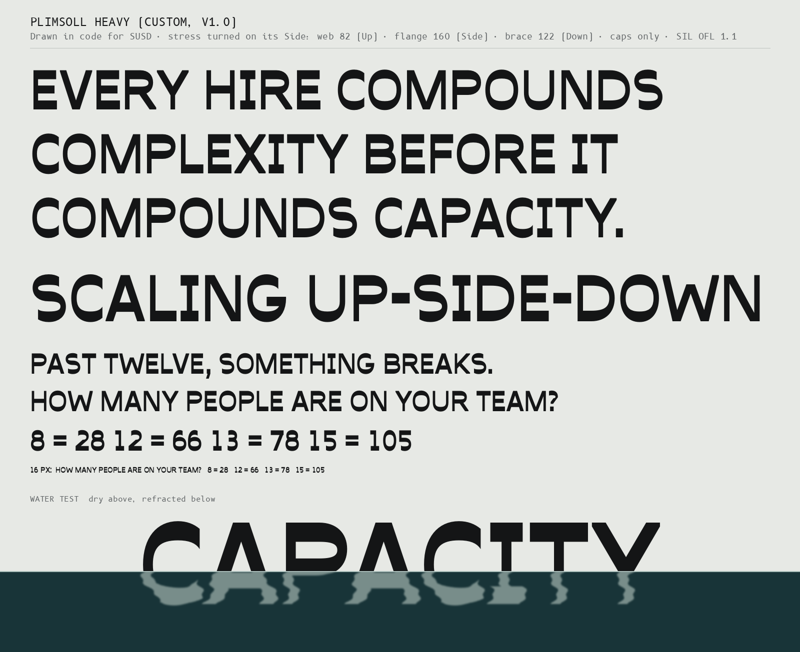
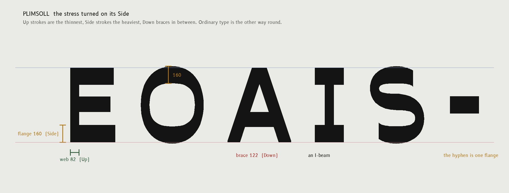
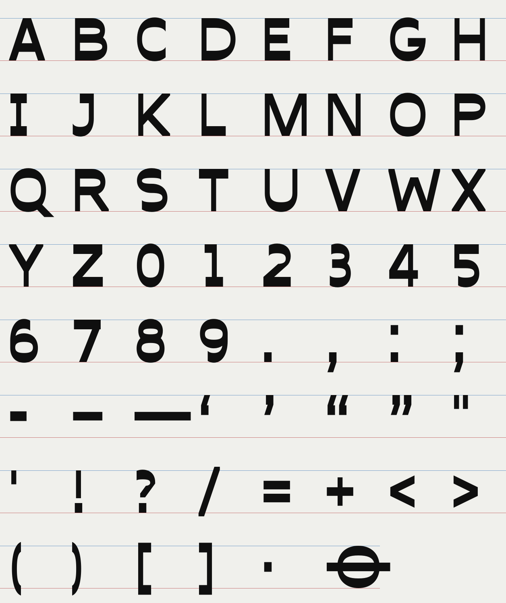
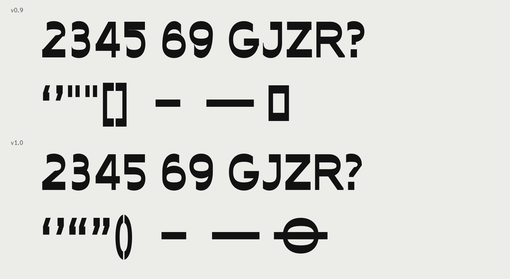
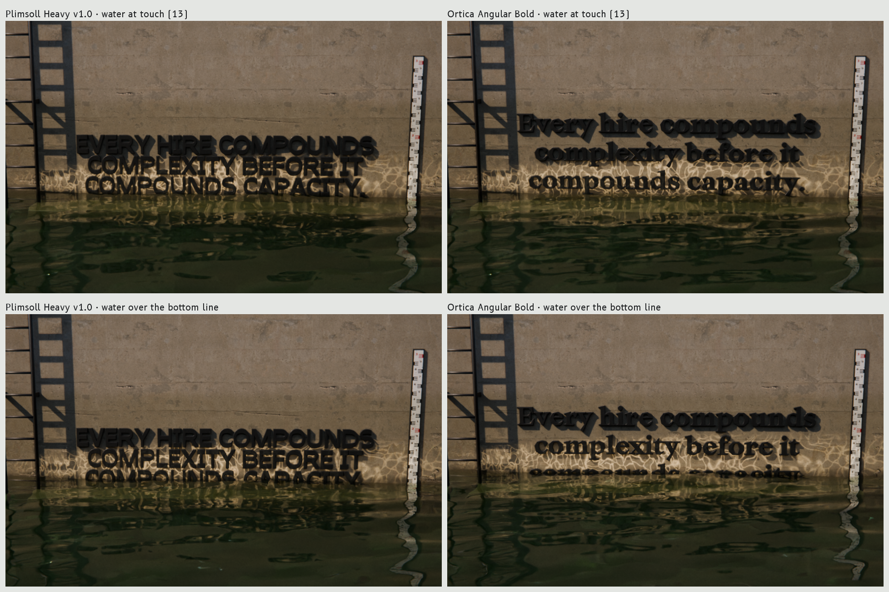

# 03 · TYPE

### What the Waterline's words are set in, why, and the typeface we made for it

James, in his words:

> "find intresting fonts that ai wouldetn use. make your own. idk. ... try your best to derive meaning ... document everything and make this good."

> "If you have blocks and left aligned text then rn you just look at the blocks and don't read the text."

> "the user should only need to scroll nothing else if they don't want to. It should get the point across even if they click nothing. It's all about getting clicks on the boot loader"

This document records:
- which faces were tried (18 cuts from 14 families, all with free licences that allow commercial use);
- how each was judged;
- the typeface we designed and built for the book, **Plimsoll**, and how good it honestly is;
- what the 3D renders showed;
- the exact files and settings the site and the Blender scenes should use.

Every sentence of Michael's quoted here or set in a specimen is word for word, with its reference. The list is in [`type/quotes-used.txt`](type/quotes-used.txt), and the copy checker reports 0 not found.

---

## 0. The answer

| Role on the page | Face | Exact files | Why, in one line |
|---|---|---|---|
| **3D hero letters**: the thesis "Every hire compounds complexity before it compounds capacity." [M 696] standing on the wall the water rises against | **Plimsoll Heavy v1.0** (ours) | `docs/type/system/Plimsoll-Heavy.otf` and, for Blender kerning, `docs/type/system/Plimsoll-Heavy.otf.kern.json` | All capitals on a flat baseline. At thirteen the water reaches every letter at the same moment, and past fifteen the words stay readable by their top halves as they go under. The heavy horizontals are Michael's Side axis made visible. Nobody else has this face. |
| **Title and wordmark**, readout figures (people, pathways), the two equations (Redline, Oxygen), the Bootloader's name and its mark | **Plimsoll Heavy v1.0** | `docs/type/system/web/Plimsoll-Heavy.woff2` (3.5 KB) | One face for everything on the page that is an object rather than a sentence. Its figures are tabular, so the counters don't jitter while you scroll. It also carries a Plimsoll mark (⦵, U+29B5), the load line itself. |
| **Story beats in HTML**: one line of Michael's per scroll step | **Ortica Angular Bold** (Benedetta Bovani, Collletttivo) | `docs/type/system/web/Ortica-AngularBold-latin.woff2` | A serious book face cut only from straight segments. It is literary but hard-edged, rarely seen, and on no AI default list. |
| **Supporting lines**, Michael's longer sentences, and the Step 0 question "How many people are on your team?" [BL 310] | **Ortica Linear Regular / Bold** | `docs/type/system/web/Ortica-LinearRegular-latin.woff2`, `docs/type/system/web/Ortica-LinearBold-latin.woff2` | Ortica Angular's curved twin: the same skeleton, comfortable to read at 18 to 28 px. |
| **Labels and UI**: gauge band names, units, the email field and button, the file's facts (V16 · 35,445 words · works with Claude, ChatGPT, Gemini) | **B612 Regular / Bold** (Airbus, Intactile, ENAC) | `docs/type/system/web/B612-Regular-latin.woff2`, `docs/type/system/web/B612-Bold-latin.woff2` | Drawn for reading cockpit instruments under stress, which is the right job for a water gauge. Set in sentence case and never in tracked capitals. |

**Fallback for the 3D hero** if James or Michael don't take to Plimsoll: Ortica Angular Bold in mixed case (`docs/type/system/Ortica-AngularBold.otf` + `.kern.json`). Section 4 shows what it costs: the bottom line vanishes once the water passes its x-height.

**Weight:** all six webfont files together come to 90.7 KB (woff2, Latin subsets). The old Waterline's Bricolage + JetBrains Mono came to 144 KB.

**See it:** the [system on one sheet](type/specimens/20-system-pairing.png), the same system [in Chromium at 1440 px](type/specimens/21-web-1440.png) and [at 390 px](type/specimens/22-web-390.png) (its page is [`type/web/specimen.html`](type/web/specimen.html)), and [Plimsoll against Ortica in the lock-wall render](type/specimens/3d/lock-compare.png).

---

## 1. What every face had to pass

**1. Not an AI default.** These are the faces that generated sites reach for, so none were considered: Inter, Geist, Fraunces, Instrument Serif, Newsreader, Playfair, Space Grotesk, Bricolage, DM Sans/Serif, IBM Plex, JetBrains Mono, Satoshi, Clash, General Sans, Cabinet, Archivo, Syne, Unbounded, Manrope, Outfit, Sora, Roboto, Montserrat and Poppins. The old Waterline used two of them (Bricolage Grotesque and JetBrains Mono), and James said it "looks too ai made". Type habits that read as AI-made were also ruled out, whatever the face:
- tiny monospace labels in tracked capitals;
- a soft serif headline with one word in italics;
- wide grotesk display type;
- pill buttons;
- cream paper with grain.

(`docs/02-AI-TELLS.md` doesn't exist yet. When it does, this list should be checked against it.)

**2. Character.** Would someone remember the face after one screen?

**3. Legibility at its job.** A 3D headline, a scrolling overlay and an 11 px label each need different things.

**4. Fit with the book.** This is a serious business book that argues against the usual advice, and its central picture is physical: "Three-dimensional scaling builds a structure. Each cycle adds depth, width, and height. The business has volume. It has weight. It can hold load." [BL 814]. A face for it should feel built and load-bearing. It should not feel playful or fashionable, and it should not look like a startup.

**5. As physical letters standing in water.** The face must be heavy enough to read as objects, with open counters that don't fill with shadow, and with no hairlines that vanish once refracted. There's one more test only this site has: how the waterline meets the letters (see section 4).

**6. Licence.** It must allow commercial use and self-hosting as a webfont. All 14 families here are under the SIL Open Font License 1.1.

---

## 2. The candidates

Where they came from:
- **Velvetyne** (France, libre foundry): Avara, Happy Times at the IKOB, Le Murmure, Compagnon.
- **Collletttivo** (Italy, libre foundry): Ortica, Mattone, Messapia, Necto Mono.
- **Rarely used families from the Google Fonts library**: Besley, Eczar, Hepta Slab, Young Serif, B612.
- **The Smithsonian**: Cooper Hewitt.

The files are in `docs/type/fonts/<family>/`, with each foundry's licence where one was shipped and `docs/type/fonts/OFL-1.1.txt` for the rest. Variable fonts were instanced and woff2 files decompressed by `tools/type/normalize_fonts.py`.

Every specimen sets the same five things in the same order:
- Michael's thesis in sentence case and then in capitals [M 696];
- the title [BL 795];
- "Past twelve, something breaks." [M 3509] and "How many people are on your team?" [BL 310];
- the pathway figures the water follows (8 = 28, 12 = 66, 13 = 78, 15 = 105);
- a "water test", where one word is cut by a waterline and refracted below it, since hairlines and tight counters fail there first.

`tools/type/specimen.py` makes them.

Scores run from 1 (poor) to 5 (strong). "In water" is judged from the water test and, for five faces, from real Blender renders (section 4).

| # | Face | Foundry · designer | Character | Legibility | Fits the book | In water | Verdict |
|---:|---|---|:-:|:-:|:-:|:-:|---|
| 00 | [Plimsoll Heavy v1.0](type/specimens/00-plimsoll-heavy.png) | ours (section 3) | 5 | 4 (caps) | 4 | **5** | **3D hero, title, figures, equations** |
| 01 | [Ortica Angular Bold](type/specimens/01-ortica-angular-bold.png) | Collletttivo · Benedetta Bovani | 5 | 4 | **5** | 3 | **HTML story beats**; 3D fallback |
| 02 | [Ortica Linear Bold](type/specimens/02-ortica-linear-bold.png) / [Regular](type/specimens/18-ortica-linear-regular.png) | Collletttivo · Benedetta Bovani | 3 | 5 | 5 | 3 | **Supporting lines** |
| 03 | [Hepta Slab Black](type/specimens/03-hepta-slab-black.png) | Michael LaGattuta | 3 | 3 | 2 | 4 | No |
| 04 | [Besley Black](type/specimens/04-besley-black.png) | Owen Earl (indestructible type\*) | 3 | 4 | 3 | 4 | No |
| 05 | [Messapia Bold](type/specimens/05-messapia-bold.png) | Collletttivo · Luca Marsano | 3 | 4 | 2 | 3 | No |
| 06 | [Mattone Black](type/specimens/06-mattone-black.png) | Collletttivo · Nunzio Mazzaferro | 3 | 3 | 2 | 4 | No |
| 07 | [Eczar ExtraBold](type/specimens/07-eczar-extrabold.png) | Rosetta · Vaibhav Singh | 4 | 4 | 3 | 3 | No |
| 08 | [Young Serif](type/specimens/08-young-serif.png) | noirblancrouge · Bastien Sozeau | 4 | 4 | 3 | 2 | No |
| 09 | [Cooper Hewitt Heavy](type/specimens/09-cooper-hewitt-heavy.png) | Village · Chester Jenkins, for the Smithsonian | 2 | 5 | 3 | 4 | No |
| 10 | [B612 Mono](type/specimens/10-b612-mono.png) | Airbus · Intactile · ENAC | 3 | 5 | 3 | n/a | No |
| 11 | [Necto Mono](type/specimens/11-necto-mono.png) | Collletttivo · Marco Condello | 3 | 4 | 2 | n/a | No |
| 12 | [Avara Black](type/specimens/12-avara-black.png) | Velvetyne · Raphaël Bastide and contributors | 4 | 4 | 3 | 4 | Runner-up for the beats |
| 13 | [Happy Times at the IKOB Bold](type/specimens/13-happy-times-bold.png) | Velvetyne · Lucas Le Bihan | 3 | 5 | 2 | 2 | No |
| 14 | [Le Murmure](type/specimens/14-le-murmure.png) | Velvetyne · Jérémy Landes | 5 | 2 | 1 | 2 | No |
| 15 | [Compagnon Medium](type/specimens/15-compagnon-medium.png) | Velvetyne · Juliette Duhe, Leonard Mabille, Chloe Lozano, Valentin Papon, Sebastien Riollier (as credited in the previous run's notes; the font's name table names Sebastien Riollier) | 3 | 4 | 2 | 1 | No |
| 16-17 | [B612 Bold](type/specimens/16-b612-bold.png) / [Regular](type/specimens/17-b612-regular.png) | Airbus · Intactile · ENAC | 3 | 5 | 4 | n/a | **Labels and UI** |

Why each one got its verdict, in a line or two:

- **Ortica Angular Bold.** Released by Collletttivo in 2019 (these files are v2.000, 2021). In the foundry's words: "Ortica Bold takes inspiration from the work of Czech designer Vojtech Preissig: like his Preissig Antiqua it's made just of straight segments." It is the most distinctive serious face of the lot: bookish without looking antique, and hard-edged without being cold. Its straight facets also echo Plimsoll's straight braces, so the two sit together. In water it is good but not best. Its wedge serifs break up when refracted, and as mixed case its descenders get wet before the rest (section 4).
- **Ortica Linear.** The same skeleton drawn with curves, so it is calmer and very legible. It takes the longer lines that Ortica Angular would make jagged at small sizes.
- **Hepta Slab Black.** Heavy, so the 3D objects would be convincing, but at Black the counters of a, e and s close up, and in shadow they fill in. It also reads as a playful poster or a Western, not as this book.
- **Besley Black.** A clean Clarendon. Clarendon revivals have been a branding trend for years, so on this page it would read as retro styling rather than argument.
- **Messapia Bold and Mattone Black.** Extended sans faces. Wide sans display type is the startup and streetwear look James means by "AI".
- **Eczar ExtraBold.** Warm and calligraphic, but literary in a fantasy-novel way, and the thin joins disappear in the water test.
- **Young Serif.** Charming 1970s weight, but there's only one regular weight, which is too light to stand as an object.
- **Cooper Hewitt Heavy.** Very legible and very neutral: nothing to remember.
- **B612 Mono and Necto Mono.** Good faces, but monospace UI labels are one of the clearest AI-site tells. B612 proportional gives the same instrument feel without it.
- **Avara Black.** Slightly irregular, so it feels drawn by hand, and it renders well in 3D. It came second for the beats. It lost to Ortica because its irregularity reads as art or editorial rather than business.
- **Happy Times at the IKOB.** Witty in its details, but at reading distance it is Times, which reads as "default font".
- **Le Murmure.** The most striking face here and the least suitable: fashion-condensed, with alternate shapes that make words hard to read, and thin.
- **Compagnon.** A typewriter face reads as an archive or a generated document, and it is too light to stand up as 3D letters.
- **B612.** Airbus commissioned it for cockpit displays: open apertures, unambiguous figures, designed to be read in a glance under pressure. That is exactly the job of the gauge, the band names and the form. Nobody uses it for websites.

---

## 3. Plimsoll, our own face



### 3.1 The idea, derived from the book

Michael names three axes and says which one gets the attention [BL 806-810]:

| Axis | Michael's gloss |
|---|---|
| Up | "Growth (the axis everyone obsesses over)" [BL 808] |
| Side | "Stabilization (the axis no one sees)" [BL 809] |
| Down | "Optimization (the axis everyone fears)" [BL 810] |

Ordinary typefaces do what the businesses in his book do. Their weight sits in the verticals, the Up strokes, and the horizontals are thin. Plimsoll turns the stress on its Side:

- **Every stroke is drawn by one rectangular nib moved without rotating.** This is Gerrit Noordzij's "translation", with the nib stood on its end.
- **A stroke that travels Up comes out thin** (82 units, the web).
- **A stroke that travels Side comes out heavy** (160 units, the flange): twice the weight.
- **A Down stroke, the diagonal brace, comes out in between** (122 units).

In type history this is called reverse contrast, the 19th-century "Italian" wood type, so the genre is old. What's new here is the reason for it and how it is built. The horizontals carry the load, "It has weight. It can hold load." [BL 814], like the flanges of a steel section.

Three details follow from that one rule:

- **The I is an I-beam.** A web and two flanges, the only letter with "serifs", because it is the structural member.
- **The hyphen is one flange.** It is the heaviest stroke there is, because in this title the hyphens carry the meaning: "The hyphens aren't decoration—they're the rhythm." [BL 795]. In SCALING UP-SIDE-DOWN the hyphens are the joints of the structure.
- **The name.** The Plimsoll line is the load line painted on a ship's hull: a disc with a horizontal bar through it, marking how deep the loaded ship may sit in the water. While the water stays below the line the ship is safe; once the water is above it, the ship is overloaded. That is the Waterline's Redline drawn as a symbol, so the face carries the mark itself as a glyph (⦵, U+29B5 CIRCLE WITH HORIZONTAL BAR). The page can use it as the Bootloader's icon or as the marker at twelve on the gauge.

The rounds follow the same rule: their sides are web-thin and their tops and bottoms flange-heavy. Their outer contours are superellipses (exponent 2.2) and their counters squarer (2.6), so the bowls look engineered rather than drawn with a compass.



### 3.2 Construction

| Parameter | Value | Note |
|---|---|---|
| Units per em | 1000 | |
| Cap height | 700 | caps only; lower case maps to the capitals |
| Web (Up strokes) | 82 | after narrowing |
| Flange (Side strokes) | 160 | middle bars 142 (optically lighter) |
| Brace (Down strokes) | 122 | perpendicular thickness, on every diagonal |
| Overshoot | 12 | rounds above the cap line and below the baseline |
| Superellipse exponent | 2.2 outer, 2.6 counter | |
| Narrowing | 0.93 | every glyph is drawn wide and then narrowed, to keep it off the wide-grotesk look |
| Figures | tabular, 530 advance | readouts that change on scroll don't jitter |
| Space | 240 | |
| Kerning | 48 pairs | in GPOS for browsers and in a legacy `kern` table (see section 5.4) |

The outlines are computed, not traced:
- Straight strokes are rectangles.
- Diagonals are a rectangle swept along a line (an exact Minkowski sum, so every outline is clean lines and cubic curves with points at the extremes).
- Rounds are a superellipse minus its counter.
- Everything is joined with skia-pathops booleans.

The build script is [`tools/type/build_plimsoll.py`](../tools/type/build_plimsoll.py). It writes a UFO (`type/custom/Plimsoll-Heavy.ufo`) and compiles it with ufo2ft to CFF OpenType and woff2.

**Character set** (64 glyphs, 92 code points): A-Z (a-z map to them), 0-9, and `. , : ; - ‐ ‑ – — ‘ ’ “ ” ' " ! ? / = + < > ( ) [ ] ·` plus no-break space and ⦵. The no-break hyphen (U+2011) is there so the title can never break at its own joints.



### 3.3 What v1.0 repaired (the proofs of v0.9 showed these)



The previous run's v0.9 proof ([`history/v0.9-proof.png`](type/custom/history/v0.9-proof.png)) looked fine at text size. At 220-900 px it had construction errors, which I found by eye and confirmed by dumping the outlines:

| Glyph | v0.9 fault | v1.0 fix |
|---|---|---|
| 6, 9 | Two overlapping rounds made a crescent and a notch inside the bowl | The upper stroke is the upper-left of a full-height round of the same width. It meets the bowl at the bowl's equator through a straight web, because both curves are vertical there, so there is no kink. 9 is 6 turned. |
| 5 | The bowl sat 3 units under the top bar: a hairline, and no open counter | The bowl is lowered so there are 94 units of air between it and the top bar. The stem now shows. |
| 2 | Steps where the curve met the diagonal; a spur at its foot | New exact construction: the Down stroke's lower edge is tangent to the bowl (solved numerically) and its upper edge lands flush on the base's end. |
| ? | Inverted-L join; tall chopped terminal | Hook, then a Down stroke placed by its edges from a shoulder on the bowl to a short Up stem over the dot. The foot is cut exactly where the edges meet. |
| Z, 4 | Bars overhung the diagonal by 32-40 units (spurs) | Braces are now placed by their edges, so the joins are flush. |
| 3, 5, J | Terminal cuts fell inside the side stroke and left 1 to 19 unit slivers ("ticks") | Cuts moved past the stroke, so each terminal is one clean upright cut. |
| G | The bar stuck out 13 units below the curve | Bar clipped to the bowl's outer contour. |
| R | 4-unit step where the leg leaves the bowl | Leg cut higher, inside the bowl's flange. |
| “ ” ( ) | Curly double quotes mapped to two straight sticks; parentheses were square brackets | Real curly quotes (the comma, raised and paired); real parentheses (the left third of a tall round, thin in the middle and heavy where they turn). |
| all | Boolean overlaps left 1-unit segments after rounding | A clean-up pass drops segments of 1.5 units or less. An outline audit now finds 0 segments under 12 units and 0 sliver contours. |
| new | | U+2011 no-break hyphen, U+00A0 no-break space, U+29B5 the Plimsoll mark, a legacy `kern` table for Blender. |

The proof after the repairs: [`type/custom/Plimsoll-proof.png`](type/custom/Plimsoll-proof.png). The earlier history: [`v1-boxes-and-patches`](type/custom/history/v1-boxes-and-patches.png) → [`v2-true-nib-sweep`](type/custom/history/v2-true-nib-sweep.png) → [`v2-vs-v3-narrower-more-contrast`](type/custom/history/v2-vs-v3-narrower-more-contrast.png) → v0.9 → v1.0.

### 3.4 How good is it, honestly

**What is good**
- **One rule, applied everywhere.** Every stroke follows the Up/Side/Down rule, so the face looks designed rather than assembled. The rule comes from the book, not from a mood board.
- **Clean outlines.** They are exact and audited, so they extrude cleanly in Blender with no overlapping contours.
- **Unmistakable and impossible to mistake for an AI default.** Nobody else has it.
- **Readable at 16 px** in capitals ([specimen](type/specimens/00-plimsoll-heavy.png), last text line), and very strong large.
- **The best of all the faces in water** (section 4).

**Where it is weaker than the professional faces here (Ortica above all)**
- **Capitals only.** A sentence in caps reads more slowly than mixed case. That suits three lines on a wall or a title; it would not suit a paragraph.
- **Spacing rests on 48 hand-set kerning pairs.** Ortica has about 9,000. Common pairs in the book's words look right, but unusual pairs (names, other copy) may not.
- **No optical fine-tuning where strokes meet.** There are no ink traps and no thinning at junctions. Large, the joins in K, R and the crotch of the 2 look slightly heavy next to a face drawn by hand over months.
- **A slight 1970s "engineering" flavour from the superellipse rounds.** Set wide and tracked out, it could tip into sci-fi. Keep the tracking tight and the case as drawn.
- **One weight.** The tabular 1 looks loose in a static number at display size ("13").
- **No accents** (é, ü) and no lower case.

**Verdict:** it is good enough to carry the 3D hero sentence and the title, which are short, in capitals, large, and finished by real light in 3D. It is also good enough for figures, the two equations and the Bootloader's name. It is not a text face: keep it out of sentences longer than one line in HTML, and out of labels.

The thesis is the one sentence where Plimsoll is both the 3D object and HTML text (its static fallback and screen-reader text). There it is set in Michael's sentence case and displayed as capitals, so assistive tech reads the sentence normally.

---

## 4. The 3D test: what the lock-wall renders show

The lookdev's current staging is the lock wall (`lookdev/stage_c_lock.py`): letters stand off weathered concrete, with a staff gauge beside them and water that rises. Each face was rendered there under identical settings. The only difference is the face: 960×600, 24 samples, about 50 s each, run through `tools/type/type3d.py`, which leaves `lookdev/renders.jsonl` alone.



What it shows:

1. **At "touch" (the water reaches the words: thirteen people, 78 pathways).** With Plimsoll's capitals on one flat baseline, the water meets every letter of the bottom line at the same moment. That is the event the story needs. With Ortica in mixed case, the water meets only the tails of p and y in "compounds capacity.", a few letters early, which reads as an accident.
2. **At "over" (past fifteen; the words go under).** Ortica's bottom line disappears almost at once, because lower case keeps its mass in the x-height band and once that is under, only ascender stubs and i-dots show. Plimsoll's capitals stay readable by their top halves as they sink: in the render "COMPOUNDS CAPACITY" is still legible with half of every letter under water. So the sinking reads as a process (the business drowning) instead of a cut.
3. **Both faces get dark shadow twins under the hard sun.** That hurts every face equally; see 5.4.

The settings the render job should use come from two more plates:
- [Plimsoll set at touch](type/specimens/3d/lock-touch-plimsoll-set.png)
- [Plimsoll set at over](type/specimens/3d/lock-over-plimsoll-set.png)

The earlier flooded-room tests from the previous run are in `type/specimens/3d/*-over.png` (Avara, Besley, Hepta, Ortica, Plimsoll v0.9).

Two technical findings matter for every 3D frame, whatever the face:

- **Blender applies no kerning.** In Blender 4.5, text objects ignore both the OpenType GPOS kerning and a legacy `kern` table. Measured with Plimsoll at size 1: "AV" is 1.2905 wide with or without kerning, which is exactly the unkerned sum. Blender does have per-character kerning (`TextCharacterFormat.kerning`, in 1/64 em), so [`tools/type/blender_kern.py`](../tools/type/blender_kern.py) writes the font's pairs into it. Kerned, "AV" measures 1.2345, as predicted, and "Y." goes from 0.8124 to 0.7303. Ortica's 9,086 GPOS pairs are applied the same way.
- **Line pitch for capitals.** `stage_c_lock.py` spaces lines at 1.08 × (ascent + descent), measured from the geometry. Capitals have no descenders, so that leaves 0.08 of a cap height between lines, and the shadows of one line fill the next. At 1.32 × cap height the three lines separate cleanly.

---

## 5. The system: exact files and how to use them

### 5.1 Files

Everything the site and the renders need is in `docs/type/system/`. Licences and copyrights are in [`type/system/FONTLOG.md`](type/system/FONTLOG.md) and `OFL-1.1.txt`.

| Use | File |
|---|---|
| Blender, 3D hero | `docs/type/system/Plimsoll-Heavy.otf` + `docs/type/system/Plimsoll-Heavy.otf.kern.json` |
| Blender, fallback | `docs/type/system/Ortica-AngularBold.otf` + `.otf.kern.json` (also `Ortica-LinearBold.otf.kern.json`) |
| Web | `docs/type/system/web/Plimsoll-Heavy.woff2` (3.5 KB) |
| Web | `docs/type/system/web/Ortica-AngularBold-latin.woff2` (15.6 KB) |
| Web | `docs/type/system/web/Ortica-LinearRegular-latin.woff2` (18.3 KB) |
| Web | `docs/type/system/web/Ortica-LinearBold-latin.woff2` (18.0 KB; optional, only for the Step 0 question) |
| Web | `docs/type/system/web/B612-Regular-latin.woff2` (21.7 KB) |
| Web | `docs/type/system/web/B612-Bold-latin.woff2` (13.5 KB) |
| Full fonts (desktop, PIL, re-subsetting) | `docs/type/system/*.otf`, `*.ttf`, `*.woff2` |
| Plimsoll source | `docs/type/custom/Plimsoll-Heavy.ufo`, built by `tools/type/build_plimsoll.py` |

### 5.2 CSS

```css
@font-face { font-family: "Plimsoll"; src: url("fonts/Plimsoll-Heavy.woff2") format("woff2"); font-weight: 800; font-display: block; }
@font-face { font-family: "Ortica Angular"; src: url("fonts/Ortica-AngularBold-latin.woff2") format("woff2"); font-weight: 700; font-display: swap; }
@font-face { font-family: "Ortica Linear"; src: url("fonts/Ortica-LinearRegular-latin.woff2") format("woff2"); font-weight: 400; font-display: swap; }
@font-face { font-family: "Ortica Linear"; src: url("fonts/Ortica-LinearBold-latin.woff2") format("woff2"); font-weight: 700; font-display: swap; }
@font-face { font-family: "B612"; src: url("fonts/B612-Regular-latin.woff2") format("woff2"); font-weight: 400; font-display: swap; }
@font-face { font-family: "B612"; src: url("fonts/B612-Bold-latin.woff2") format("woff2"); font-weight: 700; font-display: swap; }
```

`font-display: block` applies to Plimsoll only: it is 3.5 KB, and a fallback face would flash the title and the figures in some other face first. Preload it.

### 5.3 Setting rules

- **Plimsoll**
  - Line-height 0.92-0.98 for stacked capitals; letter-spacing 0 to 0.01em, never wider.
  - Write the source text in Michael's case. The font draws capitals and screen readers get the sentence.
  - Use `font-variant-numeric: tabular-nums` (the default anyway) for the people and pathways counters.
  - Never set it below 16 px.
- **The title:** `Scaling <span style="white-space:nowrap">Up&#x2011;Side&#x2011;Down</span>`. It may break at the space, so phones get SCALING over UP-SIDE-DOWN, but never at a hyphen. (The first web shot broke after "UP-SIDE-"; that is why U+2011 is in the font.)
- **Ortica Angular Bold** is for one-line beats at 30-64 px, line-height about 1.04, with `text-wrap: balance`.
- **Ortica Linear** is for 18-28 px lines, line-height about 1.3.
- **B612** is for 13-17 px labels in sentence case: no tracked capitals and no monospace.
- **Over renders**, light text needs a gradient scrim of about 30-58% black, as in [the 1440 shot](type/specimens/21-web-1440.png). All three faces held up over the darkest part of the lock render there.
- **Contrast of roles:** Plimsoll for the things you'd measure (the sentence on the wall, numbers, equations, the file), Ortica for Michael's voice, B612 for the instrument. Don't swap them.

### 5.4 Blender (for the render job)

- **Font:** `bpy.data.fonts.load('<repo>/susd-render/docs/type/system/Plimsoll-Heavy.otf')`. The text can stay in Michael's case, because the font maps lower case to capitals.
- **Kerning:** after `cu.body` and `cu.font` are set, add:
  ```python
  sys.path.insert(0, '<repo>/susd-render/tools/type'); import blender_kern
  blender_kern.apply(cu, '<repo>/susd-render/docs/type/system/Plimsoll-Heavy.otf')
  ```
  If the font file changes, re-export the sidecar with `python3 -I tools/type/blender_kern.py <font>`.
- **Tracking:** `cu.space_character = 1.03`. Shadows fill the gaps, so 3D capitals want a little more air than print.
- **Line pitch:** 1.32 × the cap height. The cap height is 0.7 × `cu.size` before any rescale; measure it from the mesh after the rescale.
- **Depth and bevel:** the lock staging's 0.035 m depth on 0.26 m capitals (about 0.13 cap) with a 0.004 m bevel works. For close-ups raise `cu.resolution_u` from 6 to 12 so the superellipse rounds don't facet.
- **Water levels from the font:**
  - "touch" (13): the bottom line's baseline, since there are no descenders.
  - "words go under" (16+): the levels between each line's baseline and its cap line, at 0.7 × size above the baseline.
  - "air above them" (Oxygen): above the top line's cap line.
- **Shadow twins:** under a hard low sun the dark letters get a full black shadow copy. Lighter paint, the sky key or a smaller stand-off will keep the words reading as one set of letters. This is the render job's call, but it affects legibility more than any type choice.

`tools/type/type3d.py` already does all of this as options (`--kern 1 --track 0.03 --capspitch 1.32`), wrapping the staging script without editing it.

---

## 6. Not done, and next

- **Plimsoll lower case.** It isn't needed for the hero or the title; it would be needed for any longer Plimsoll text.
- **Plimsoll accents.**
- **A proportional figure set** (`pnum`) for static numbers.
- **A Medium weight** for 12-16 px.
- **More kerning pairs** once the final page copy is fixed. Run `tools/type/proof.py` on every line that will be set in Plimsoll and kern what looks open.
- **James and Michael haven't seen Plimsoll yet.** The fastest test is the [Plimsoll set at touch](type/specimens/3d/lock-touch-plimsoll-set.png) plate next to [Ortica at touch](type/specimens/3d/lock-touch-ortica.png). If they reject Plimsoll, Ortica Angular Bold takes the hero and Plimsoll keeps the title, the figures and the Bootloader mark, where it is strongest anyway.

---

## 7. Index of files and scripts

| Path | What |
|---|---|
| `docs/type/fonts/<family>/` | the 14 candidate families as downloaded (+ instanced/decompressed copies) |
| `docs/type/specimens/00-18-*.png` | one specimen per candidate (section 2) |
| `docs/type/specimens/20-system-pairing.png` | the recommended system on one sheet |
| `docs/type/specimens/21-web-1440.png`, `22-web-390.png` | the system as webfonts in Chromium (desktop, phone) |
| `docs/type/specimens/3d/lock-*.png` | lock-wall renders (section 4); `lock-compare.png` is the 2×2 |
| `docs/type/specimens/3d/*-over.png` | the previous run's flooded-room tests |
| `docs/type/custom/` | Plimsoll: `.otf`, `.woff2`, `.ufo`, specimen, proof, glyphs, construction, `history/` |
| `docs/type/system/` | the shipped fonts, `.kern.json` sidecars, `web/` subsets, `FONTLOG.md`, `OFL-1.1.txt` |
| `docs/type/web/specimen.html` | the Chromium test page (with `bg-lock-touch.png`, a lookdev render) |
| `docs/type/quotes-used.txt` | every quote set in a specimen, with refs (copy-checked) |
| `tools/type/build_plimsoll.py` | builds Plimsoll |
| `tools/type/proof.py`, `glyphgrid.py`, `construction.py`, `specimen.py`, `before_after.py`, `pairing.py` | proof sheets (PIL) |
| `tools/type/normalize_fonts.py` | decompress woff2, instance variable fonts, print name tables |
| `tools/type/shoot_specimen.cjs` | Chromium screenshots of the test page |
| `tools/type/type3d.py`, `render_type3d.sh`, `render_type3d_final.sh`, `compare3d.py` | 3D type tests in the lookdev stagings |
| `tools/type/blender_kern.py` | kerning for Blender text objects |

**Reproduce everything** (from `susd-render/`):
```bash
python3 -I tools/type/build_plimsoll.py                       # -> docs/type/custom/Plimsoll-Heavy.{otf,woff2,ufo}
cp docs/type/custom/Plimsoll-Heavy.{otf,woff2} docs/type/system/ && cp docs/type/custom/Plimsoll-Heavy.woff2 docs/type/system/web/
python3 -I tools/type/blender_kern.py docs/type/system/Plimsoll-Heavy.otf docs/type/system/Ortica-AngularBold.otf docs/type/system/Ortica-LinearBold.otf
python3 -I tools/type/proof.py docs/type/custom/Plimsoll-Heavy.otf docs/type/custom/Plimsoll-proof.png
python3 -I tools/type/glyphgrid.py docs/type/custom/Plimsoll-Heavy.otf docs/type/custom/Plimsoll-glyphs.png "ABCDEFGHIJKLMNOPQRSTUVWXYZ0123456789.,:;-–—‘’“”\"'!?/=+<>()[]·⦵" 150
python3 -I tools/type/specimen.py docs/type/custom/Plimsoll-Heavy.otf docs/type/custom/Plimsoll-specimen.png "Plimsoll Heavy (custom, v1.0)" "<meta line>" --caps
python3 -I tools/type/construction.py && python3 -I tools/type/pairing.py
node tools/type/shoot_specimen.cjs                            # needs playwright on the module path
tools/type/render_type3d.sh && tools/type/render_type3d_final.sh && python3 -I tools/type/compare3d.py   # Blender; waits for a free CPU
node ../susd-options/tools/copycheck.mjs docs/type/quotes-used.txt
```
