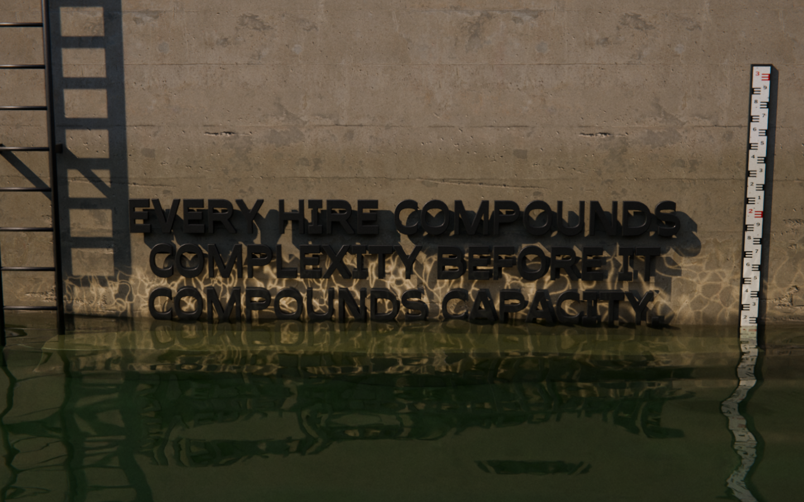
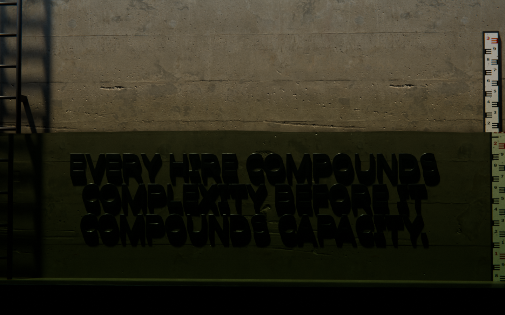
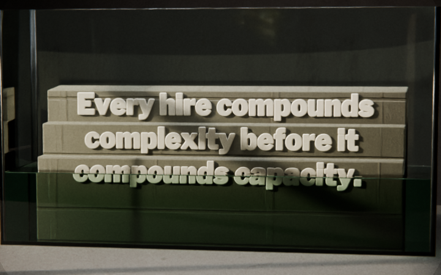
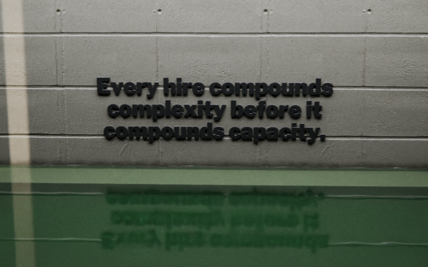
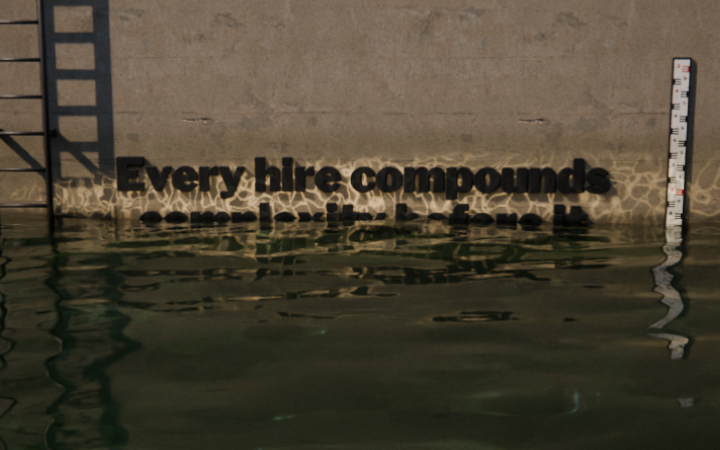
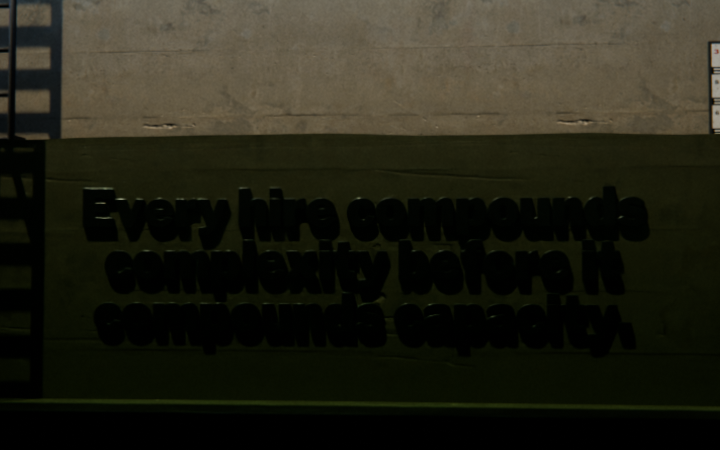
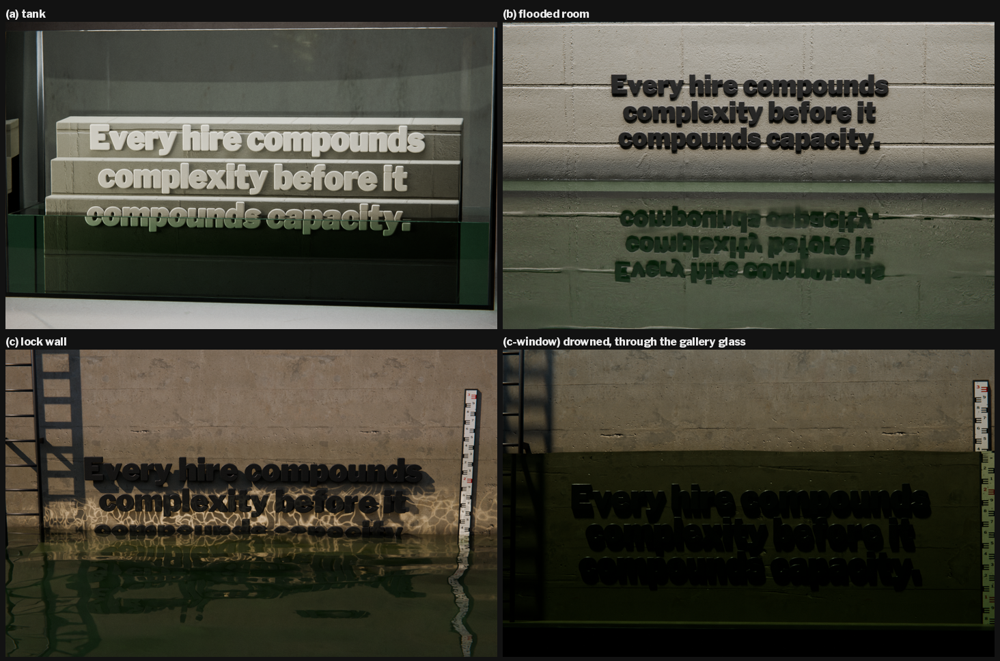
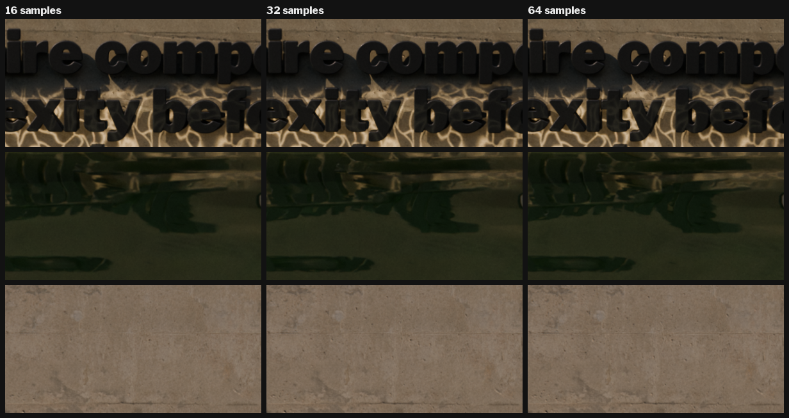
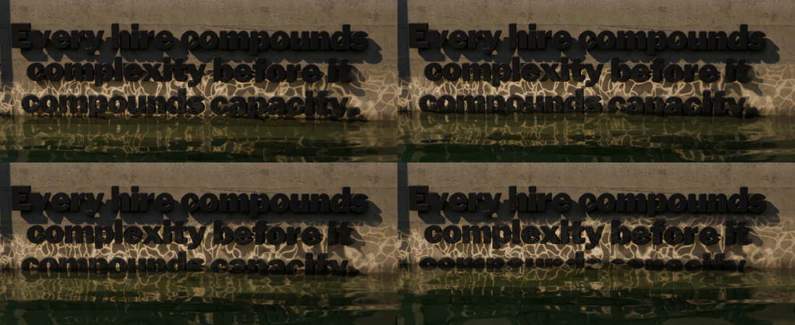

# 05 · Render pipeline: Blender look-dev for the water and the words

**Job.** Find, by rendering, the setup that makes the Waterline look like a *photograph of a real
thing* while Michael's thesis stays legible, within the CPU we have. The thesis is
"Every hire compounds complexity before it compounds capacity." [M 696]: three lines of physical letters with real water rising against them.
This page covers what was tried, what won, the exact settings, what it costs, and what bit us.

Everything here is in `susd-render/`: scripts in `lookdev/`, renders in `lookdev/{a,b,c,full}/`,
the log of every render in `lookdev/renders.jsonl`.

---

## 0. The answer

**Recommended: staging (c), the lock wall.** The sentence is fixed to the weathered concrete far
wall of an outdoor canal-lock chamber, above a cast landing step (the ground the words stand
on). Beside it is an enamel E-pattern staff gauge, the real instrument for reading a water
level, and a steel ladder whose rungs every 0.3 m give an honest scale. The water surface is
real geometry (light wind chop). Low sun bounces off the chop and throws moving glitter onto
the wall just above the water. Below old high-water marks the wall carries a silt stain, so
every cycle leaves a ring.

**For the drowned beats (past fifteen), use the same scene from a second camera: c-window.**
That camera stands in a dark observation gallery behind a glass wall in the lock. From above
the water, a drowned sentence on a vertical wall cannot be read, because at the grazing angles
you need to read a wall the water surface is a mirror (see c10/c11). Through glass it stays
legible: darker, green, refracted and slightly magnified. That is the "over-under" view the
brief asked for in (a), at architectural scale, in the same lock.

| | |
|---|---|
| Best open-water still (water crossing line 3, glitter) | [`lookdev/full/c_lock_1440_s32.png`](../lookdev/full/c_lock_1440_s32.png) |
| Best drowned still (all three lines under, readable) | [`lookdev/full/c_window_1440_s32.png`](../lookdev/full/c_window_1440_s32.png) |
| Best 720 test of the lock (water at the top line) | [`lookdev/c/c09_high.png`](../lookdev/c/c09_high.png) |
| Cost per frame, 1440×900, OIDN | **74 s at 16 samples** (sequence), 148 s at 32 (stills); 1600×1000 costs ×1.2 |
| 120 frames, 1440×900, 16 samples | **≈ 2 h 30 min** of CPU (measured per frame in one session) |


**With the final face** (Plimsoll Heavy, kerned, caps pitch 1.32, through `tools/type/type3d.py`):
- at "touch" (thirteen), glitter 0.3: [`full/c_lock_plimsoll_touch_1440_s32.png`](../lookdev/full/c_lock_plimsoll_touch_1440_s32.png);
- drowned, through the gallery glass: [`full/c_window_plimsoll_drown_1440_s32.png`](../lookdev/full/c_window_plimsoll_drown_1440_s32.png).





What the Plimsoll frames show:
- Drowned, it reads clearly and looks genuinely underwater.
- Dry, in raking sun, the near-black enamel and its own cast shadow merge, so Plimsoll's heavy
  capitals read doubled. Fix this with paint and standoff (item 7 in section 5), not with a
  different staging.

---

## 1. Blender: version, install, machine

- **Blender 4.5.15 LTS** (build 2026-10-22, hash 5afeabba6097), installed from the official
  Linux x64 tarball at `/opt/blender-4.5.15-linux-x64/`, linked as `/usr/local/bin/blender`.
  To reproduce on another machine, download `blender-4.5.15-linux-x64.tar.xz` from
  download.blender.org/release/Blender4.5/, unpack it, and put `blender` on the PATH. Nothing
  else is needed: the scripts use only Blender's bundled Python (`bpy`, `bmesh`, `mathutils`,
  `numpy`).
- **Machine:** 4 CPU cores, no GPU. Cycles runs on the CPU. EEVEE is slower here (software GL),
  and its refraction and volumes are screen-space approximations.
- **One render at a time.** Two Cycles jobs on four cores take longer than the two run back to
  back, and the timings become meaningless. The type team renders through the same staging, so
  every timed render here went through [`tools/render_idle.py`](../tools/render_idle.py). It
  waits until no other `blender` is running, runs the job, and writes `cpu_shared_s` (seconds
  another Blender overlapped) into the job's log row. Every timing quoted below has
  `cpu_shared_s = 0`.

## 2. How to run

From `susd-render/`:

```bash
# one still (the 720 test size)
blender -b -P lookdev/stage_c_lock.py -- --w 720 --h 450 --samples 24 --level over --out lookdev/c/test.png
# the drowned view through the gallery glass
blender -b -P lookdev/stage_c_lock.py -- --w 720 --h 450 --samples 24 --window 1 --level drown --out lookdev/c/test_w.png
# a timed, CPU-polite full-size frame
python3 tools/render_idle.py blender -b -P lookdev/stage_c_lock.py -- --w 1440 --h 900 --samples 32 --level over --out lookdev/full/x.png
# a sequence in one session (persistent data): one frame per water height, in metres
blender -b -P lookdev/stage_c_lock.py -- --w 1440 --h 900 --samples 32 --seq 1.10,1.16,1.22,1.28 --out out/seq/f.png
# with the final face (Plimsoll Heavy), kerned, caps line pitch (the type team's wrapper)
blender -b -P tools/type/type3d.py -- --stage c --font $PWD/docs/type/system/Plimsoll-Heavy.otf --kern 1 --track 0.03 --capspitch 1.32 --w 1440 --h 900 --samples 32 --level touch --out x.png
# all full-size timings in this document
bash lookdev/full_timings.sh
```

`--level` takes `below | touch | over | high | drown` or a height in metres above the lock
floor. Other options are listed in each script's docstring.

| File | What it is |
|---|---|
| [`lookdev/lib_lookdev.py`](../lookdev/lib_lookdev.py) | Shared library: Cycles/AgX setup, Poly Haven scanned materials (box-mapped, with wet band and tide stain), type as real bevelled geometry, water bodies (`water_box` with meniscus, `ocean_water` with real waves), water shader, glass, lights (sun, area, spot, gobo projector), real camera, compositor post, timed render with log. |
| [`lookdev/stage_a_tank.py`](../lookdev/stage_a_tank.py) | Staging (a): glass tank, letters on a stepped concrete plinth inside. |
| [`lookdev/stage_b_room.py`](../lookdev/stage_b_room.py) | Staging (b): flooded concrete room, letters on the back wall. |
| [`lookdev/stage_c_lock.py`](../lookdev/stage_c_lock.py) | Staging (c): outdoor lock wall. `--window 1` gives the gallery-glass view (c-window). `--seq` renders a sequence. |
| [`lookdev/full_timings.sh`](../lookdev/full_timings.sh) | The full-size timing batch (every staging at 1440×900 and 1600×1000, a sample ladder, a 4-frame sequence). |
| [`lookdev/renders.jsonl`](../lookdev/renders.jsonl) | One JSON row per render: size, samples, seconds, look, Blender version, staging options and (from c onward) the exact `argv`. |
| [`tools/render_idle.py`](../tools/render_idle.py) | Waits for a free CPU, runs the render, records any overlap. |
| [`tools/fetch_polyhaven.py`](../tools/fetch_polyhaven.py) | Downloads CC0 Poly Haven textures and HDRIs and logs them to `assets/polyhaven/SOURCES.tsv`. |
| [`tools/make_staff_gauge.py`](../tools/make_staff_gauge.py) | Paints the enamel staff gauge texture (`assets/generated/staff_gauge.png`). |
| [`lookdev/sheets/`](../lookdev/sheets/) | Contact sheets of every test, by staging. |

## 3. What "looks real" meant (the bar every test was judged against)

What has to be in the frame:
- a nameable place and a nameable light (a skylight slot, the sun, a gallery window);
- scanned surfaces with dirt, tie holes, stains and wet bands;
- water with the right index (1.333), green-tinted depth, a waterline that is not ruled straight, reflections, and caustics;
- a real lens (50 to 85 mm, slight depth of field);
- AgX, finished like a photograph (halation, lateral colour, vignette, grain).

What gets killed on sight: “3D text on a gradient”, plastic or toy letters, game-engine water,
anything symmetrical and clean enough to be a template, cream paper, and drop-shadow type.
(See `docs/02-AI-TELLS.md` when it exists.)

Legibility: at 1440 px the letters must read at a glance whenever they are dry, and the
waterline must be unambiguous.

---

## 4. The stagings tried

All tests are 720×450, 24 samples, adaptive threshold 0.02, OIDN, AgX Medium High Contrast,
with Libre Franklin Black standing in for the final face. Contact sheets:
[a](../lookdev/sheets/a_contact.png) · [b](../lookdev/sheets/b_contact.png) · [c](../lookdev/sheets/c_contact.png).

### (a) Glass tank, head-on, over-under split (`stage_a_tank.py`, a01–a11)

A rimless low-iron glass tank, 1.2 × 0.46 × 0.66 m, with silicone corner beads, on a concrete
stand against a dark plaster wall. Inside, a three-step cast-concrete plinth carries the three
lines as painted steel letters. Water fills it to the chosen level (a 3 mm meniscus on every
wall). An aquarium luminaire is the key; a window to camera left (with a mullion and transom)
gives the wall its light. 70 mm, f/8.



- **Works:** the brief's split. Above the line the letters are crisp; below it they are darker,
  green and refracted, and still **readable through the front glass**. The meniscus line on the
  glass sells it. Cheap: 21–28 s at 720.
- **Fails:** it reads as a product shot of a model. The letters look like toys: rounded, uniform
  pale paint, small in a big box. The camera sits above the water, so the surface is seen from
  above and the waterline doubles (front-glass line plus surface line). A scatter haze (a07) helps
  the water but turns it into "aquarium". A pale plinth with pale letters loses contrast.
- **Verdict:** right optics, wrong world. Its one irreplaceable property, readable drowned
  words, is carried into c-window at room scale.

### (b) Flooded concrete room (`stage_b_room.py`, b01–b08)

A board-formed concrete room, 7.2 m wide and 4.2 m high, with a roof slot along the back wall
(sky panel and/or sun). The sentence is in stand-off painted steel letters on the back wall
above a raised ledge (the ground). The room is flooded; the camera stands near the front above
the water, 50–55 mm, f/5.6.



- **Works:** the first test that read as a photograph (b08). Matte black signage letters on real
  concrete, a slot of sunlight from a side slit, a green mirror of water doubling the words.
  The words are big and dead legible when dry.
- **Fails:** once the water passes the letters, they vanish (b05/b06). The camera has to be
  near the water to see the mirror, so the surface is at a grazing angle and reflects instead of
  showing what is under it. The ripple bump on a perfectly flat top makes the reflected wall
  joints into long wavy wires (b04–b06). Indoors and dim, it reads a little like a gallery
  installation.
- **Verdict:** strong runner-up for the dry beats; no answer for the drowned ones.

### (c) The lock wall (`stage_c_lock.py`, c01–c11): recommended

My own idea, built from what (b) taught: put the same wall outdoors, in a place whose job is
to rise and fall, and add the instruments a real lock wall has. Outdoor lock chamber, far wall
in weathered in-situ concrete (Poly Haven `concrete_wall_007`) with a precast coping. A cast
landing step (the ground; Side raises it). Painted steel letters 3 cm proud. An enamel staff
gauge and a painted steel ladder on brackets. The water is a baked Ocean-modifier surface:
Phillips spectrum, 2.2 m/s wind, scale 0.07, so the waterline on the wall is irregular. Sun at
42° elevation raking from the left, a partly cloudy sky HDRI, silt-stained wall below an old
high-water mark, and a wet band 12 cm above the water. 50 mm, f/8, from the far coping 8.4 m
away and 3 m up.



How it got there (each step is an image in `lookdev/c/`):
1. c01: the sun at 28° from the front put the near wall's shadow over the words, and the swell
   was ocean-sized. → Sun to 42°/250° (raking from the left), wind 2.2 m/s, scale 0.07.
2. c02–c04: a hard dark band below 2.6 m was the tide stain, not a shadow (a bug, see
   pitfalls). → Fixed and softened to about −0.3 stops with a ragged, streaky edge.
3. c05: +0.8 EV (raking light gives little irradiance; a photographer would open up), clearer
   water, lower camera (3.0 m) for more reflection. The first frame that reads as a place.
4. c05–c09: sun glitter on the wall. The first two projector placements failed (c05 streaks,
   c06/c07 a fan); the third (c08) works and was halved (c09). See pitfalls.
5. c10/c11: drowned. **The words disappear completely**: at any camera height that can read
   the wall, the chop is a mirror. Clearer water and a higher camera do not change that.

- **Works:** the most photographic frames of the whole look-dev (c09_high). The glitter, the
  irregular waterline, the gauge and the ladder reflected in the chop, the drowned step's
  caustics. The staff gauge and ladder make it unmistakably a real place with a real water
  level. The tide ring makes "each cycle starts higher" visible on the wall itself.
- **Fails:** drowned words are invisible (c10). Hence c-window.

### (c-window) The same lock through a gallery window (`--window 1`, c12–c19)

A dry observation gallery (dark painted room) with a 40 mm laminated glass wall standing in the
lock 0.8 m in front of the wall. The camera is at eye level (1.65 m) in the gallery, 50 mm,
f/5.6. The sun is higher (70°) so the gallery roof does not shade the words, and its disc is
softer (3°). Letters are flush-mounted, 2 cm deep, so a steep sun does not throw a second
copy of every letter beneath it.



- **Works:** the drowned sentence stays readable (c17/c19 drown), which nothing else here
  manages. When the level passes the camera, the underside of the surface turns into the
  silver mirror of total internal reflection. That is the visitor going under with the words.
- **Fails and limits:** dimmer and more constructed than the open view. Raking light with
  stand-off letters doubles every letter (c17), hence flush letters. With the eye above the
  water, refraction hides a band of wall just under the surface, and the band grows with the
  glass-to-wall gap: 2.2 m hid about 16 cm (c16), which is why the glass is 0.8 m from the wall.
- Getting this to render at all took three geometry fixes (c12–c16). They are in the pitfalls,
  because they apply to any water seen through its side.
- **At full size** ([`full/c_window_1440_s32.png`](../lookdev/full/c_window_1440_s32.png)) all
  three lines read under water. The staff gauge shows the real refraction break at the
  waterline: the drowned part is magnified and offset, which tells the eye there is glass and
  water, not a filter. Two things to tune before the sequence:
  - It is dim and low in contrast (dark letters on dark green). Lift it about +0.5 EV for the
    drowned frames, or give the letters a mid-tone paint that reads both dry and drowned.
  - The bottom tenth is dead floor. Aim the camera about 0.2 m higher.

### Verdict

**(c) + (c-window).** The lock is the only staging that looks like a place someone photographed,
not a set built to be photographed. Its instruments (gauge, ladder, tide ring) let the water
level *mean* something without a caption. The window camera answers the one thing open water
cannot show: the sentence drowning while still readable.

**Fallback: (b).** At full size, the flooded room is the cleanest and most legible dry frame,
with a perfect mirror. If James finds the lock too busy, (b) with the same window trick for the
drowned beats is the next best. It costs the same (149 s at 32 spp).

---

## 5. Recommended setup (exact)

Not yet built, and needed for the sequence (in order):
1. Glitter at `--wc 0.3`. It still reads a little like a pool net at 0.5.
2. The window camera: +0.5 EV for the drowned frames, and aim it 0.2 m higher.
3. Side mechanics: put the words on a precast panel standing on the landing, and add courses
   under the landing (section 7).
4. The meniscus on the gallery glass: at 6.8 m a 3 mm meniscus is about one pixel, so it is
   optional. `water_box` has the code if wanted.
5. A portrait camera for phones.
6. Recompute the level control points from the final face (Plimsoll caps, pitch 1.32).
7. **Letter paint and shadow.** Near-black letters merge with their own cast shadow in raking
   sun (very visible with Plimsoll). Try a lighter enamel or the cover green (#2B5A37) with 1 cm
   standoff. A lighter letter also reads better under water (compare the pale letters in a).

These are the defaults in `stage_c_lock.py`; nothing has to be passed for the open view except
`--level`, and `--window 1` switches every window default at once.

**Render (both cameras)**

| Setting | Value | Why |
|---|---|---|
| Engine | Cycles, CPU, 4 threads | no GPU here |
| Samples | **16 for sequence frames, 32 for stills**, adaptive threshold 0.02, fixed seed | after OIDN, 16, 32 and 64 are indistinguishable at 100% on letters, water and concrete (ladder in section 6). 32 is kept for posters and print; the fixed seed means static areas denoise identically frame to frame (no boil) |
| Denoise | OpenImageDenoise, albedo + normal passes, prefilter Accurate, quality High | |
| Light paths | max 24, diffuse 3, glossy 3, transmission 8, transparent 24, volume 1 (0 if no scatter), clamp indirect 4, reflective and refractive caustics off | caustics come from the shadow-ray trick and the projector instead |
| Persistent data | on | keeps textures and the BVH between frames of a sequence |
| Colour | AgX, look **Medium High Contrast**, exposure **+0.8 EV** (window **+1.1**) | AgX keeps highlights (glitter, gauge) from clipping to flat white |
| Output | PNG 8-bit, 1440×900 (desktop) | pack to WebP/AVIF later |

**Camera.** Open view: **50 mm** on a 36 mm sensor, **f/8**, focus on the words. It stands at
(0.35, −8.4, 3.0) m, on the far side of the chamber at the coping, looking at the words' centre
line. Window view: **50 mm, f/5.6**, eye level 1.65 m in the gallery, 6.8 m from the wall.

**Light.**
- Sun: **4.5**, elevation **42°**, azimuth **250°** (raking from the left, a little from the
  front), disc 0.55°, 5000 K. Window view: elevation 70°, azimuth 235°, disc 3°.
- Sky: HDRI `kloofendal_48d_partly_cloudy_puresky` at strength 1.0 (window 1.4), rotated 150°,
  its sun clamped at 6.
- Wall glitter: a projector spot just above the water at (−0.8, −3.2, level + 0.03) m, aimed at
  level + 0.20 m. 13° cone, blend 0.9, object scale (12, 1, 1). Voronoi caustic gobo, scale 26,
  aspect 0.10. Strength 700 × `--wc`. Use **`--wc 0.3`** for finals: 0.5 still reads a little
  "pool" at full size. Off in the window view.

**Water** (`water_mat` + `ocean_water`).
- Principled transmission 1.0, **IOR 1.333**, roughness 0, with a dust-film roughness patch up to 0.08.
- Volume absorption colour (0.22, 0.50, 0.26) linear, toward the cover green #2B5A37, density
  **1.0** (window 0.9). Scatter 0.08 (window 0.04), colour (0.30, 0.55, 0.34), anisotropy 0.55.
- Ocean surface baked per frame: spatial size 12 m, resolution 12, wind **2.2 m/s**, wave scale
  **0.07**, choppiness 0.5 (0 in the window view, so nothing pulls away from the glass), 5 cm grid,
  plus a fine ripple bump of 0.03.
- Shadow-ray caustics 0.8, cell scale 2.6.
- The wall is wet for 12 cm above the water (darker, glossier, ragged edge). The silt stain
  sits below the high-water mark `--hw` (−0.3 stops, olive, streaked).

**Materials.**
- Lock wall: `concrete_wall_007` at 0.36/m (one tile ≈ 2.8 m).
- Letters: satin enamel on steel (base 0.075/0.085/0.08 sRGB, roughness 0.48 ± 0.11 from a
  scanned map, orange-peel bump), 3.5 cm deep, with a 3 cm gap behind them (front face 6.5 cm
  off the wall). Item 7 above suggests 1 cm and a lighter paint. Window view: 2 cm deep,
  flush.
- Gauge: enamel (coat 0.4).

**Post (compositor).** Fog-glow glare 0.12 above 1.2; lens dispersion 0.004 then a 1.2% crop;
optical vignette plate 0.22; film grain plate 0.07 overlay, shifted every frame.

**Type.** Final frames use Plimsoll Heavy through the type team's wrapper, with kerning on,
tracking 0.03 and a caps line pitch of 1.32 (`docs/03-TYPE.md`, section 5.4). The stand-in
Libre Franklin is only for look-dev.

**Phone.** The 16:10 frame cannot be cropped to 390×844 and keep the sentence readable. Render a
second, portrait camera (same scene, 9:19.5, about 35 mm equivalent, closer) as its own sequence,
or let the phone layout carry the sentence in HTML over a cropped plate.

## 6. Timings and cost

Measured on this machine: 4 CPU cores, Cycles on the CPU, OIDN, one render at a time.
Every row has `cpu_shared_s = 0`. The raw rows are in `lookdev/renders.jsonl`, and the batch is
`lookdev/full_timings.sh` (output in `full_timings.log`). Times are the render call itself.
Blender start-up and scene build add 3–6 s per *session*, not per frame.

**Per frame, full size**

| Staging | 1440×900 | 1600×1000 | Notes |
|---|---|---|---|
| (a) tank, 32 spp | 92.9 s | 113.3 s | small scene, the cheapest |
| (b) flooded room, 32 spp | 149.4 s | 188.6 s | big glossy mirror area |
| **(c) lock wall, 32 spp** | **148.4 s** | **178.1 s** | |
| **(c) lock wall, 16 spp** | **78.2 s** | ≈ 94 s (scaled) | holds up after denoise: see the ladder |
| (c) lock wall, 64 spp | 280.9 s | – | no visible gain over 32 |
| (c-window) drowned, 32 spp | 119.5 s | 143.6 s | |

A 1600×1000 frame costs 1.20–1.26× a 1440×900 frame (it has 1.23× the pixels).

All four at 1440×900: [`lookdev/sheets/stagings_full.png`](../lookdev/sheets/stagings_full.png)



**Sample ladder.** 100% crops of the same 1440 frame: letters with glitter, water, and bare
concrete.



After OIDN (albedo + normal), 16, 32 and 64 samples are indistinguishable at 100%. 16 is the
sequence setting; 32 is kept for stills that may be printed or zoomed.

**Sequences.** One Blender session, persistent data on, water level changing every frame.

| Run | Frame times | Per frame |
|---|---|---|
| 4 frames, 1440×900, 32 spp (`full/c_seq_00{1-4}.png`) | 142.9 / 139.6 / 138.3 / 140.5 s | ≈ 140 s |
| 3 frames, 1440×900, 16 spp (`full/c_seq16_00{1-3}.png`) | 76.3 / 72.8 / 73.8 s | ≈ 74 s |



Persistent data saves only about 8 s a frame here: the time is in sampling, not in scene sync.

**A 120-frame sequence of the lock**

| Setting | Per frame | 120 frames |
|---|---|---|
| **1440×900, 16 spp (recommended)** | ≈ 74 s | **≈ 2 h 30 min** |
| 1600×1000, 16 spp | ≈ 90 s | ≈ 3 h |
| 1440×900, 32 spp | ≈ 140 s | ≈ 4 h 40 min |
| 1600×1000, 32 spp | ≈ 170 s | ≈ 5 h 40 min |
| phone portrait sequence (separate camera, ~0.6 Mpx) | ≈ 40 s (estimate) | ≈ 1 h 20 min (estimate) |

At the recommended settings, a full desktop + phone set is about **4 hours of CPU**. Run it
overnight through `render_idle.py` with nothing else on the machine. For comparison, the old
site needed about 30 s a frame for a simpler, dry scene; water, glass and volumes cost about
2.5× that.

Ways to cut it if needed:
- Render every other water height and let the site crossfade. Level changes are slow and
  monotonic, so 60 rendered frames can be shown as 120.
- Render at 1440×900 and let the browser scale up. The frames are photographs, and the grain
  hides the scaling.
- Drop the scatter haze (`--scatter 0`) to save about 10%. The water turns a little glassier.

## 7. Mapping the story onto the lock (for the sequence step)

What the lock gives the story, beat by beat. (This is guidance for the sequence step. The
heights below are measured from the stand-in type; recompute them from the final face.)

**Water level per hire.** Pathways p = n(n−1)/2. As in the previous Waterline build, the level is
piecewise linear in p between control points measured from the words:

| Headcount n | Pathways p | Water | In the lock (stand-in type: words 1.08–2.20 m, landing 0.70 m) |
|---|---|---|---|
| 1 | 0 | a puddle | 0.15 m |
| 8 | 28 | up the landing step | 0.60 m |
| 12 | 66 | laps just under the words, dry | words' bottom − 0.06 m |
| 13 | 78 | **touches the words** | words' bottom + 0.02 m (`--level touch`) |
| 15 | 105 | halfway up the words | middle of the words |
| 20 | 190 | **over** | words' top + 0.25 m (`--level drown`) |
| 39 | 741 | Redline, deep | words' top + 0.6 m |

Each hire adds n − 1 pathways, so every step of water is bigger than the last. The compounding
shows on the gauge.

**The cycle in this scene.**
- **Down** drains: the sluices open and the level falls. The wet band and the silt ring stay at
  the high-water mark (`--hw`), so the wall remembers how bad it got.
- **Side** raises the ground. My recommendation: fix the letters to a precast panel that stands
  on the landing, and lay new precast courses under the landing. Panel and words rise course by
  course, measured against the staff gauge, which stays bolted to the lock wall.
- **Up** grows again: the water rises with the next hires, but stops below the raised words.
  Each cycle starts higher and leaves its own ring.
- **The end (Oxygen):** the landing several courses up, the words high and dry with sky light on
  them, calm water well below.
- **The drowned beats** (from 15 to the Redline) cut to the window camera: same water height,
  same scene. Once the level passes 1.65 m the visitor is under the surface with the words.

**Sequence mechanics.** `--seq z1,z2,...` renders one frame per water height in one Blender
session. Each frame moves the level empty (wet band, glitter), rebuilds the baked ocean mesh at
the new height with ocean time +0.04 s (barely moving water, so scrubbing reads as level change
and not as flicker), and re-seeds the grain shift. The site can crossfade between frames. A
level change is slow, so 2–3 frames per hire is enough.

## 8. Assets used (all free to use; nothing AI-generated)

All in `assets/` (large files are gitignored; re-fetch with `tools/fetch_polyhaven.py`). Every
Poly Haven file is listed with its URL in [`assets/polyhaven/SOURCES.tsv`](../assets/polyhaven/SOURCES.tsv).

| Asset | Source | Licence | Used in |
|---|---|---|---|
| `concrete_wall_007` (diff, rough, nor_gl), 2K | Poly Haven, polyhaven.com/a/concrete_wall_007 | CC0 | (c) lock wall (weathered in-situ concrete with tie holes and stains) |
| `concrete_wall_008`, 2K | Poly Haven | CC0 | (c) landing step, cast letters option; (b) side walls, ledge |
| `concrete_wall_004`, 2K | Poly Haven | CC0 | (b) board-formed back wall; (a) cast plinth |
| `precast_concrete_wall`, 2K | Poly Haven | CC0 | (c) coping |
| `concrete_floor_worn_001`, 2K | Poly Haven | CC0 | (c) lock floor; (b) floor; (a) stand top |
| `painted_plaster_wall`, 2K | Poly Haven | CC0 | (a) back wall; (c-window) gallery paint |
| `metal_plate`, 2K (roughness only) | Poly Haven | CC0 | roughness breakup of the letters' enamel paint (all stagings) |
| `rusty_metal_02`, 2K (roughness only) | Poly Haven | CC0 | roughness breakup of the ladder paint (c) |
| `smooth_concrete_floor`, `rusty_painted_metal` | Poly Haven | CC0 | downloaded, not used in the final setups |
| HDRI `kloofendal_48d_partly_cloudy_puresky`, 2K | Poly Haven | CC0 | (c) sky (its sun is clamped out; a sun lamp owns the shadows) |
| HDRI `kloofendal_overcast`, 2K | Poly Haven | CC0 | (b) |
| HDRI `photo_studio_loft_hall`, 2K | Poly Haven | CC0 | (a), very low, reflections only |
| HDRI `empty_warehouse_01`, `overcast_industrial_courtyard` | Poly Haven | CC0 | downloaded, not used |
| Staff gauge texture `assets/generated/staff_gauge.png` (200 × 6000 px, 2 px/mm, 3 m) | painted by `tools/make_staff_gauge.py` (PIL): the standard E-pattern, decimetre numerals, red metre numerals, enamel chips with rust halos | ours | (c) |
| Libre Franklin Black / ExtraBold (`assets/fonts/*.ttf`) | npm `@fontsource/libre-franklin` 5.3.0, converted to TTF for Blender | OFL-1.1 | stand-in letters for every test; gauge numerals |
| Big Shoulders Display Black | npm `@fontsource/big-shoulders-display` 5.3.0 | OFL-1.1 | downloaded, not used |
| **Final 3D face: Plimsoll Heavy** | ours, `docs/type/system/Plimsoll-Heavy.otf` (+ `.kern.json`), see `docs/03-TYPE.md` | ours (OFL-compatible system) | final frames, via `tools/type/type3d.py` |

The grain and the vignette are generated plates (numpy) built inside Blender at render time.
No photographs or AI images are used anywhere.

## 9. Pitfalls (each one cost a render or more)

1. **Water seen through its side rendered black** (c14–c16). The ocean water mesh had a smooth
   top and *flat-shaded* sides (`sharp_face`). In Cycles 4.5, rays refracting in through those
   flat side faces came out black whenever the volume shader was on. Without the volume they
   were fine (diagnostics d1–d8). Fix: make every face smooth and mark edges sharp by angle,
   as `water_box` does. That is now in `ocean_water`.
2. **Never close water with a Solidify modifier** over displaced waves. Solidify extrudes along
   wave-tilted normals, so the bottom shifted sideways by up to 14 cm and the sides became wavy
   slanted sheets. That is invisible where the sides are buried in walls; through glass it opens
   air gaps and traps rays (flat olive murk, c12/c13). `ocean_water` bakes the surface, pins its
   rim to the rectangle, then extrudes the whole region down to a flat **quad-grid** bottom.
   Closing the bottom with one n-gon of ~1000 collinear rim vertices (`edgeloop_fill`) also
   failed: it triangulates into slivers.
3. **Grazing water is a mirror.** To read a vertical wall you look nearly horizontally, and at
   that angle the surface reflects instead of showing what is under it. Drowned words on a wall
   cannot be shown from above the water (b05/b06, c10/c11). To keep them, look through glass
   (a, c-window).
4. **The blind band behind glass.** With the eye above the water, refraction at the glass flattens
   the rays, so a band of wall just under the surface is hidden. Its height is about
   gap × slope × (1 − 1/1.333). A 2.2 m gap hid 16 cm (c16); 0.8 m hides about 4 cm.
5. **`build_line` puts the FRONT face on y=0.** The body runs back to y=+depth. Its docstring said
   the opposite, so letters placed at `-standoff` were partly sunk into the wall, and fully sunk at
   standoff 0 (c18: letters "missing"). Place them at `-(standoff + depth)`. The docstring is fixed;
   the a and b stagings still carry the old placement (their letters stand 4 mm and 12 mm proud).
6. **The tide stain multiplied in linear space** (c02–c04). A stain colour of 0.12 sRGB is 0.013
   linear, so the wall below the old high-water mark went near-black and looked like a shadow.
   `add_stain` now takes `mul_srgb`, what white becomes under the stain (0.80 ≈ −0.3 stops).
7. **Long letter shadows look like drop-shadow type.** With a steep or grazing sun, letters
   standing off a wall cast a full copy of themselves below (c17: 36 cm offset). That is a
   "3D text" tell. Keep the standoff small (2–3 cm), soften the sun disc (2–3°), and avoid a sun
   that only grazes the wall.
8. **Sun glitter on walls is a projector, not physics.** Real reflected caustics are far too
   noisy on CPU.
   - A spot at the sun's mirror point below the water was blocked by the submerged step (c06).
     With shadow linking it threw a soft diagonal fan instead of a band (c07). The light-space
     mask I wrote was wrong (c05: streaks high on the wall).
   - What works (c08/c09): a low spot just above the water in front of the wall, a narrow cone
     widened sideways by scaling the light object (a scaled spot has an elliptical cone), and a
     Voronoi caustic web stretched sideways (`gobo_caustics(..., aspect=0.1)`).
   - Keep it subtle. At full strength it reads as a pool net.
9. **Underwater caustics are a shadow-ray trick.** The water surface is transparent to shadow rays,
   modulated by a caustic web on the upward faces (`water_mat(caustic=...)`). It is nearly free
   and only lights what is under the water. Cycles' MNEE was tested (`--caustics mnee` in stage
   a, a13 against a12; [comparison](../lookdev/sheets/a_mnee_vs_surface.png)). Same cost (19.4 s
   against 21.2 s), but everything under the water went black: with MNEE the surface must be a
   real refractive caster, so direct sun and sky no longer reach the drowned letters, and MNEE
   only solves for the one area light marked as a caustics light. Not adopted.
10. **Lens dispersion leaves dark corners.** Lens Distortion with Fit and dispersion left a black
    wedge in the corners (b04/b06). `post()` now crops 1.2% after it, like a lens hood.
11. **Exposure.** Raking light delivers little irradiance (the sun at 25° to a wall gives ~25% of
    its strength). Expose like a photographer (+0.8 to +1.1 EV) instead of brightening the lights,
    which would blow the sky reflections.
12. **The HDRI's own sun.** Clamp it out (`world_hdri(clamp=6)`) when a sun lamp owns the
    shadows, or every object gets two shadows.
13. **Blender applies no kerning** (found by the type team): text objects ignore GPOS and the
    legacy `kern` table. `tools/type/type3d.py` writes the pairs into Blender's per-character
    kerning. Capitals need more line pitch (1.32 × cap height) than the 1.08 × (ascent +
    descent) the stagings use.
14. **Font paths must be absolute.** `load_font` joins the name onto `assets/fonts/`, so a
    relative `--font docs/...` becomes `assets/fonts/docs/...` and the job dies. Pass an absolute
    path (`$PWD/docs/type/system/Plimsoll-Heavy.otf`).
15. **Shared CPU.** The type team renders through `stage_c_lock.py` too. Two Cycles jobs at once
    make both slower and every timing wrong; use `tools/render_idle.py`.
16. **Blender 4.5 API notes.**
    - `ShaderNodeMix` sockets share names across data types, so resolve them by identifier
      (`lib.mix()`).
    - Lens Distortion's Fit, Jitter and Distortion are input sockets.
    - Shadow linking is `light.light_linking.blocker_collection`.
    - The Ocean modifier is applied by evaluating the depsgraph (`new_from_object`).
    - `RNA_float_get: NodeSocket.default_value not found` in the log is harmless (Glare node
      options that are properties, not sockets).
